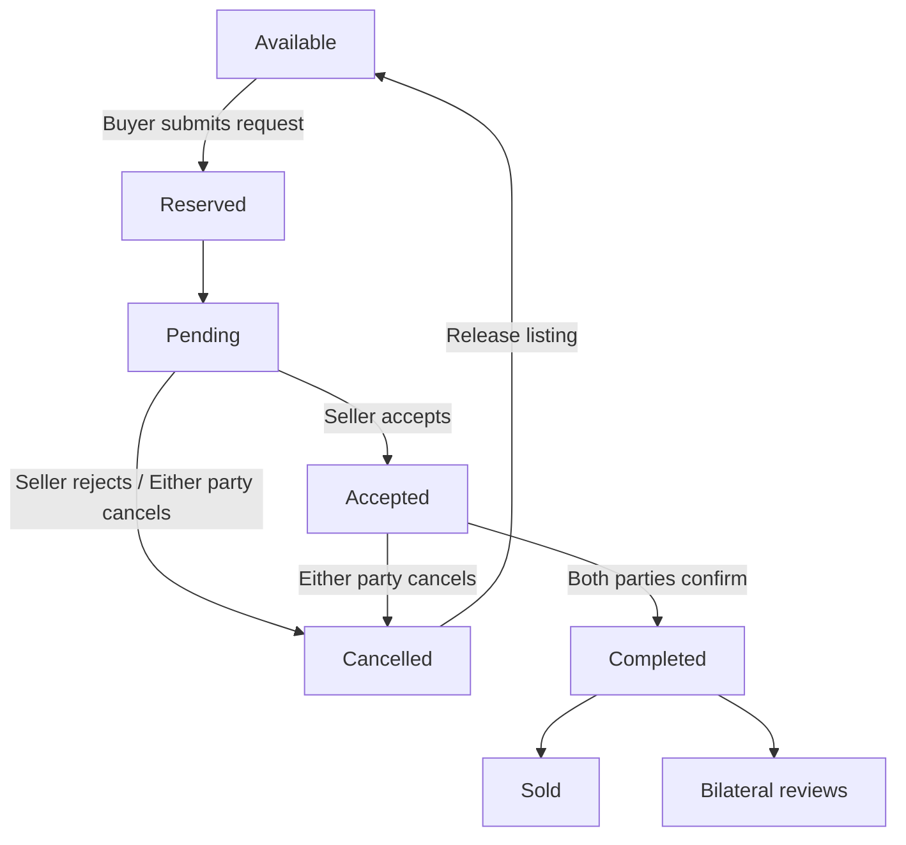
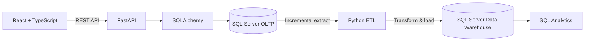

# Chợ Trời UIT | UIT Student Marketplace

**Nền tảng C2C dành cho sinh viên UIT** — đăng bán, tìm mua và trao đổi đồ cũ, kết hợp hệ thống phân tích dữ liệu bằng Data Warehouse và ETL.

**A student-to-student C2C marketplace for UIT** — list, discover, and exchange pre-owned items, supported by a SQL Server Data Warehouse and an ETL pipeline.

[](https://github.com/Nghiepcoder17v/cho-troi-uit/actions/workflows/ci.yml)

---

## Mục lục | Contents

- [Tổng quan | Overview](#tổng-quan--overview)
- [Tính năng chính | Key Features](#tính-năng-chính--key-features)
- [Nghiệp vụ mua bán | Marketplace Workflow](#nghiệp-vụ-mua-bán--marketplace-workflow)
- [Kiến trúc và dữ liệu | Architecture & Data](#kiến-trúc-và-dữ-liệu--architecture--data)
- [Công nghệ | Technology Stack](#công-nghệ--technology-stack)
- [Cấu trúc dự án | Project Structure](#cấu-trúc-dự-án--project-structure)
- [Cài đặt local | Local Setup](#cài-đặt-local--local-setup)
- [Docker Compose](#docker-compose)
- [ETL và Analytics](#etl-và-analytics)
- [Kiểm thử và CI | Testing & CI](#kiểm-thử-và-ci--testing--ci)
- [Bảo mật | Security](#bảo-mật--security)
- [Trạng thái dự án | Project Status](#trạng-thái-dự-án--project-status)

## Tổng quan | Overview

**Tiếng Việt**

Chợ Trời UIT là marketplace C2C phục vụ cộng đồng sinh viên Trường Đại học Công nghệ Thông tin – ĐHQG-HCM. Người dùng có thể đăng bán sản phẩm đã qua sử dụng, tìm kiếm theo từ khóa hoặc danh mục, gửi yêu cầu mua và đánh giá đối phương sau khi giao dịch hoàn tất.

Dự án đồng thời xây dựng luồng dữ liệu phân tích riêng: dữ liệu nghiệp vụ được lưu trong SQL Server OLTP, sau đó ETL sang Data Warehouse dạng Star Schema để phục vụ báo cáo. Thanh toán và bàn giao sản phẩm được thực hiện bên ngoài nền tảng.

**English**

Chợ Trời UIT is a C2C marketplace for the University of Information Technology community. Students can list pre-owned items, browse and search listings, submit purchase requests, and review the other party after a transaction is completed.

The project also includes an analytics data flow: operational records are stored in SQL Server OLTP and processed into a Star Schema Data Warehouse for reporting. Payments and item handover take place outside the platform.

## Tính năng chính | Key Features

| Phân hệ / Module | Chức năng / Capabilities |
|---|---|
| **Marketplace** | Khám phá, tìm kiếm, lọc danh mục và phân trang sản phẩm. / Browse, search, filter, and paginate listings. |
| **Tài khoản / Accounts** | Đăng ký UIT, đăng nhập, cập nhật hồ sơ và đổi mật khẩu. / UIT registration, sign-in, profile updates, and password changes. |
| **Đăng bán / Listings** | Tạo, chỉnh sửa, ẩn và mở bán lại tin đăng theo trạng thái. / Create, edit, hide, and relist items according to business rules. |
| **Giao dịch / Transactions** | Yêu cầu mua, người bán chấp nhận/từ chối, hai bên xác nhận hoàn tất. / Purchase requests, seller decisions, and confirmation by both parties. |
| **Uy tín / Reputation** | Đánh giá hai chiều sau giao dịch hoàn tất. / Bilateral reviews after completed transactions. |
| **Account Center** | Quản lý hồ sơ, tin đăng, đơn mua/bán, giỏ hàng và cài đặt. / Manage profile, listings, purchases, sales, cart, and settings. |
| **Moderation & Admin Controls** | Báo cáo tin đăng, hàng đợi kiểm duyệt và moderation hold; ADMIN quản lý vai trò MODERATOR/ADMIN có audit. / Listing reports, moderation queue and holds; ADMIN manages MODERATOR/ADMIN roles with an audit trail. |
| **Data Warehouse** | Star Schema và lịch sử sản phẩm SCD Type 2. / Star Schema with SCD Type 2 product history. |
| **ETL & Analytics** | ETL tăng dần, watermark, retry, run log và báo cáo SQL. / Incremental ETL, watermarks, retries, run logs, and SQL reports. |

## Nghiệp vụ mua bán | Marketplace Workflow

Yêu cầu mua không đồng nghĩa với giao dịch đã hoàn tất. Sản phẩm được giữ chỗ trong thời gian hai bên xử lý yêu cầu.

A purchase request does not mean the transaction is complete. The listing remains reserved while the parties process the request.



- Người mua không thể tự mua sản phẩm của mình; một sản phẩm không thể có nhiều giao dịch đang mở.
- Người bán phải chấp nhận yêu cầu trước khi giao dịch chuyển sang trạng thái Accepted.
- Buyer và seller xác nhận riêng biệt sau khi tự bàn giao/thanh toán bên ngoài hệ thống.
- Chỉ khi cả hai xác nhận, giao dịch mới thành Completed và sản phẩm thành Sold.
- Chỉ giao dịch Completed mới đủ điều kiện để hai bên đánh giá nhau.

- Buyers cannot purchase their own listings, and a listing cannot have multiple active transactions.
- The seller must accept a request before it enters the Accepted state.
- Buyer and seller confirm separately after arranging payment and handover outside the platform.
- The transaction becomes Completed and the listing becomes Sold only after both confirmations.
- Reviews are available only for Completed transactions.

## Kiến trúc và dữ liệu | Architecture & Data

### Kiến trúc tổng thể | System Architecture



### OLTP, DWH và ETL

- **OLTP:** SQL Server lưu tài khoản, danh mục, sản phẩm, giao dịch và đánh giá.
- **Data Warehouse:** Star Schema gồm <code>dim_user</code>, <code>dim_product</code>, <code>dim_date</code> và <code>fact_transactions</code>; metadata ETL lưu watermark, lịch sử chạy và dòng dữ liệu bị từ chối.
- **SCD Type 2:** <code>dim_product</code> lưu phiên bản thuộc tính sản phẩm theo khoảng hiệu lực. Fact tham chiếu phiên bản có hiệu lực tại thời điểm giao dịch.
- **ETL:** extract theo <code>updated_at</code> và watermark; transform/chuẩn hóa; load dimension trước fact trong transaction; sau đó đối soát dữ liệu.

- **OLTP:** SQL Server stores users, categories, products, transactions, and reviews.
- **Data Warehouse:** A Star Schema with <code>dim_user</code>, <code>dim_product</code>, <code>dim_date</code>, and <code>fact_transactions</code>, plus ETL metadata for watermarks, run history, and rejected rows.
- **SCD Type 2:** <code>dim_product</code> preserves versioned listing attributes with effective-date ranges. Facts reference the version valid at transaction time.
- **ETL:** Extracts changes using <code>updated_at</code> and watermarks, transforms records, loads dimensions before facts in a transaction, then reconciles source and warehouse data.

ETL dùng cửa sổ overlap mặc định 5 phút để hạn chế bỏ sót commit trễ. Load được thiết kế idempotent để dữ liệu trong vùng overlap có thể được đọc lại an toàn. Lịch sử SCD Type 2 chỉ được ghi nhận từ khi tính năng được bật; pipeline không thể tái tạo những thay đổi cũ mà OLTP không lưu lịch sử.

The default ETL overlap window is 5 minutes to reduce the risk of missing late commits. Loads are idempotent, so records in the overlap window can be processed again safely. SCD Type 2 history is captured from feature activation onward; the pipeline cannot reconstruct older changes that were never retained by the OLTP source.

### Báo cáo phân tích | Analytics Reports

| Truy vấn / Query | Mục đích / Purpose |
|---|---|
| <code>top3_majors_it</code> | Top ngành học mua thiết bị IT / Top majors purchasing IT equipment |
| <code>books_peak_month</code> | Tháng cao điểm giao dịch giáo trình / Peak month for textbook transactions |
| <code>days_to_sell_by_category</code> | Thời gian bán và mức giảm giá theo danh mục / Time-to-sell and discount by category |
| <code>seller_pareto</code> | Phân tích tỷ trọng đóng góp của người bán / Seller contribution analysis |
| <code>listing_sell_through_by_category</code> | Tồn tin, giao dịch hoàn tất và sell-through theo danh mục / Listings, completed sales, and sell-through by category |

## Công nghệ | Technology Stack

| Thành phần / Component | Công nghệ / Technologies |
|---|---|
| Frontend | React 19, TypeScript, Vite 6 |
| Backend | Python 3.12+, FastAPI, Pydantic, Uvicorn |
| ORM & Database | SQLAlchemy, Microsoft SQL Server, pyodbc, ODBC Driver 18 |
| Authentication | JWT, bcrypt, HttpOnly cookies |
| Data Engineering | Pandas, NumPy, incremental ETL |
| Testing & Quality | Pytest, Ruff, TypeScript build |
| Deployment | Docker, Docker Compose, Nginx, GitHub Actions |

## Cấu trúc dự án | Project Structure

```text
cho-troi-uit/
├── backend/
│   ├── main.py
│   ├── database.py
│   ├── models.py
│   ├── schemas.py
│   ├── security.py
│   └── tests/
├── frontend/
│   └── src/
│       ├── pages/
│       ├── components/
│       ├── hooks/
│       └── utils/
├── data_pipeline/
│   ├── run_etl.py
│   ├── scheduler.py
│   ├── run_analytics.py
│   ├── etl/
│   ├── analytics/
│   └── tests/
├── database_scripts/
│   ├── 01_init_schema.sql
│   ├── 02_seed_reference_data.sql
│   └── migrations/
├── docs/
├── scripts/
├── docker-compose.yml
├── .env.example
├── .env.compose.example
└── README.md
```

## Cài đặt local | Local Setup

### Yêu cầu | Prerequisites

- Python 3.12+
- Node.js 20+
- SQL Server 2016+ hoặc SQL Server Express
- Microsoft ODBC Driver 18 for SQL Server
- Git

### 1. Clone repository

```powershell
git clone https://github.com/Nghiepcoder17v/cho-troi-uit.git
cd cho-troi-uit
```

### 2. Tạo môi trường Python và cài dependencies

```powershell
python -m venv .venv
./.venv/Scripts/Activate.ps1
python -m pip install --upgrade pip
python -m pip install -r backend/requirements-dev.txt -r data_pipeline/requirements-dev.txt
```

### 3. Chuẩn bị SQL Server

Tạo hai database riêng cho nghiệp vụ và phân tích:

```sql
CREATE DATABASE ChoTroUIT;
CREATE DATABASE ChoTroUIT_DWH;
```

Trên database OLTP mới tạo, chạy schema và dữ liệu danh mục:

```powershell
sqlcmd -S localhost -d ChoTroUIT -E -i database_scripts/01_init_schema.sql
sqlcmd -S localhost -d ChoTroUIT -E -i database_scripts/02_seed_reference_data.sql
```

> **Lưu ý quan trọng:** <code>01_init_schema.sql</code> có thao tác drop và tạo lại bảng. Chỉ chạy trên database phát triển mới hoặc database được chủ động reset. Không chạy script này trên database hiện hữu có dữ liệu cần giữ. Với database cũ, hãy backup, kiểm tra trạng thái schema và áp dụng đúng migration trong <code>database_scripts/migrations/</code>. Docker initializer cũng không tự chạy migration cho database đã tồn tại.

### 4. Cấu hình môi trường

Sao chép <code>.env.example</code> thành <code>.env</code> tại thư mục gốc:

```powershell
Copy-Item .env.example .env
```

Điền thông tin kết nối SQL Server, DWH và JWT. Ví dụ Windows Authentication:

```dotenv
DATABASE_URL=mssql+pyodbc://@localhost/ChoTroUIT?driver=ODBC+Driver+18+for+SQL+Server&trusted_connection=yes&TrustServerCertificate=yes
DWH_DATABASE_URL=mssql+pyodbc://@localhost/ChoTroUIT_DWH?driver=ODBC+Driver+18+for+SQL+Server&trusted_connection=yes&TrustServerCertificate=yes
JWT_SECRET=replace_with_a_long_random_secret
ACCESS_TOKEN_EXPIRE_MINUTES=1440
CORS_ORIGINS=http://localhost:5173
```

Tạo JWT secret ngẫu nhiên:

```powershell
python -c "import secrets; print(secrets.token_urlsafe(32))"
```

Không commit <code>.env</code>, mật khẩu, JWT secret hoặc connection string thật lên Git.

Do not commit <code>.env</code>, passwords, JWT secrets, or real connection strings to Git.

### 5. Khởi chạy backend

```powershell
Set-Location backend
../.venv/Scripts/Activate.ps1
uvicorn main:app --reload
```

Backend mặc định cung cấp:

- API health check: <code>http://localhost:8000/</code>
- Swagger UI: <code>http://localhost:8000/docs</code>
- OpenAPI JSON: <code>http://localhost:8000/openapi.json</code>

### 6. Khởi chạy frontend

Mở terminal khác:

```powershell
Set-Location frontend
npm ci
npm run dev
```

Frontend mặc định chạy tại <code>http://localhost:5173</code>. Đảm bảo backend đã cho phép origin này trong <code>CORS_ORIGINS</code>.

### 7. Build frontend production

```powershell
npm run build
npm run preview
```

## Docker Compose

Docker Compose dựng frontend production qua Nginx, FastAPI, SQL Server và các tiện ích ETL/analytics.

Docker Compose starts the production frontend behind Nginx, the FastAPI service, SQL Server, and optional ETL/analytics utilities.

```powershell
Copy-Item .env.compose.example .env.compose
```

Chỉnh <code>MSSQL_SA_PASSWORD</code> và <code>JWT_SECRET</code> trong <code>.env.compose</code>, sau đó chạy từ thư mục gốc:

```powershell
docker compose --env-file .env.compose up --build
```

Mở <code>http://localhost:8080</code>. Dừng container nhưng giữ dữ liệu database:

```powershell
docker compose --env-file .env.compose down
```

| Service | Vai trò / Purpose |
|---|---|
| <code>frontend</code> | Nginx phục vụ frontend production và proxy API |
| <code>backend</code> | FastAPI application |
| <code>sqlserver</code> | SQL Server chứa OLTP và DWH |
| <code>etl</code>, <code>analytics</code> | Công cụ chạy một lần, bật qua profile <code>tools</code> |
| <code>etl-scheduler</code> | Scheduler ETL định kỳ, bật qua profile <code>automation</code> |

Database được lưu trong Docker named volume <code>sqlserver-data</code>. Xóa volume sẽ xóa dữ liệu OLTP và DWH. Scheduler ETL không tự bật trong cấu hình mặc định.

The databases are persisted in the <code>sqlserver-data</code> named volume. Removing the volume deletes both OLTP and DWH data. The ETL scheduler is disabled by default.

Chạy ETL hoặc analytics thủ công trong Docker:

```powershell
docker compose --env-file .env.compose --profile tools run --rm etl
docker compose --env-file .env.compose --profile tools run --rm analytics
```

Bật scheduler ETL:

```powershell
docker compose --env-file .env.compose --profile automation up -d etl-scheduler
docker compose --env-file .env.compose logs -f etl-scheduler
```

Hướng dẫn chi tiết: [Docker Compose](docs/DOCKER_COMPOSE.md) · [ETL Automation](docs/ETL_AUTOMATION.md).

> **Lưu ý bảo mật:** Docker Compose hiện dùng SQL Server `sa` cho môi trường local/dev. Không tái sử dụng cấu hình này cho môi trường dùng chung hoặc production; production phải dùng application principal riêng, không thuộc `sysadmin`/`db_owner`, và principal triển khai schema riêng.

## ETL và Analytics

Chạy ETL từ thư mục gốc sau khi cấu hình <code>DATABASE_URL</code> và <code>DWH_DATABASE_URL</code>:

Run ETL from the repository root after configuring <code>DATABASE_URL</code> and <code>DWH_DATABASE_URL</code>:

```powershell
python data_pipeline/run_etl.py
```

Một số chế độ hỗ trợ:

```powershell
python data_pipeline/run_etl.py --full-refresh
python data_pipeline/run_etl.py --overlap-minutes 5
python data_pipeline/run_analytics.py --list
python data_pipeline/run_analytics.py top3_majors_it books_peak_month
```

| Exit code | Ý nghĩa / Meaning |
|---:|---|
| <code>0</code> | Thành công / Success |
| <code>1</code> | Hoàn tất nhưng có cảnh báo hoặc dòng bị từ chối / Completed with warnings or rejected rows |
| <code>2</code> | Tham số hoặc cấu hình không hợp lệ / Invalid arguments or configuration |
| <code>3</code> | ETL thất bại / ETL failed |

<code>--drop-dwh</code> xóa toàn bộ Data Warehouse; chỉ sử dụng khi chủ động dựng lại DWH từ đầu và đã có backup phù hợp. Không dùng tùy chọn này trong vận hành định kỳ.

<code>--drop-dwh</code> deletes the entire Data Warehouse. Use it only for an intentional rebuild with an appropriate backup. Never use it for routine ETL runs.

## Kiểm thử và CI | Testing & CI

Chạy backend tests / Run backend tests:

```powershell
Set-Location backend
pytest -v
```

Chạy data pipeline tests / Run data pipeline tests:

```powershell
Set-Location ../data_pipeline
pytest -v
```

Kiểm tra frontend / Build the frontend:

```powershell
Set-Location ../frontend
npm ci
npm run build
```

CI trên GitHub Actions chạy ba job độc lập cho Backend (Ruff + Pytest), Data Pipeline (Ruff + Pytest) và Frontend (TypeScript + Vite build). SQL Server integration tests là opt-in vì cần một SQL Server và database kiểm thử riêng có tên kết thúc bằng <code>_test</code>.

GitHub Actions runs three independent jobs: Backend (Ruff + Pytest), Data Pipeline (Ruff + Pytest), and Frontend (TypeScript + Vite build). SQL Server integration tests are opt-in because they require a dedicated SQL Server instance and a test database whose name ends with <code>_test</code>.

Hướng dẫn SQL Server integration tests: [docs/SQLSERVER_INTEGRATION_TESTING.md](docs/SQLSERVER_INTEGRATION_TESTING.md).

## Bảo mật | Security

- Mật khẩu được băm bằng bcrypt; JWT phiên đăng nhập được lưu trong cookie <code>HttpOnly</code>, <code>Secure</code>, <code>SameSite=Lax</code>.
- Request thay đổi dữ liệu sử dụng cookie phiên phải gửi <code>Origin</code> thuộc danh sách <code>CORS_ORIGINS</code>.
- API lấy buyer/seller identity từ phiên đăng nhập, không tin ID do client gửi lên để xác định quyền sở hữu.
- Email đăng ký phải thuộc miền <code>@gm.uit.edu.vn</code>; MSSV gồm đúng 8 chữ số và khớp phần trước <code>@</code> của email.
- Trang cá nhân công khai không trả email, MSSV hoặc password hash.
- SQL Server sử dụng foreign key, CHECK constraint, unique constraint và filtered unique index để bảo vệ tính toàn vẹn.
- Quyền MODERATOR/ADMIN được đọc từ assignment còn hiệu lực trong database ở từng request; tài khoản ADMIN đầu tiên vẫn phải được bootstrap qua operator/DBA được phê duyệt.
- ETL ghi nhận dòng bị từ chối và trạng thái mỗi lần chạy; không âm thầm nạp dữ liệu lỗi.

- Passwords are hashed with bcrypt; session JWTs are stored in <code>HttpOnly</code>, <code>Secure</code>, <code>SameSite=Lax</code> cookies.
- Cookie-authenticated state-changing requests must provide an <code>Origin</code> listed in <code>CORS_ORIGINS</code>.
- Buyer/seller identity is derived from the authenticated session, not trusted from client-supplied ownership IDs.
- Registration requires an <code>@gm.uit.edu.vn</code> email; the student ID must contain exactly 8 digits and match the email prefix.
- Public profiles do not expose email addresses, student IDs, or password hashes.
- SQL Server constraints and indexes enforce data integrity; ETL records rejected rows rather than silently loading invalid data.

## API chính | Main API

| Method | Endpoint | Mô tả / Description |
|---|---|---|
| <code>GET</code> | <code>/</code> | Health check |
| <code>POST</code> | <code>/api/auth/register</code> | Đăng ký / Register |
| <code>POST</code> | <code>/api/auth/login</code> | Đăng nhập và tạo cookie phiên / Sign in and set session cookie |
| <code>POST</code> | <code>/api/auth/logout</code> | Đăng xuất / Sign out |
| <code>GET</code>, <code>PATCH</code> | <code>/api/users/me</code> | Xem và cập nhật hồ sơ / Get and update profile |
| <code>GET</code> | <code>/api/products</code> | Tìm kiếm và phân trang / Search and paginate listings |
| <code>POST</code> | <code>/api/products</code> | Đăng sản phẩm / Create listing |
| <code>PATCH</code> | <code>/api/products/{product_id}</code> | Cập nhật tin của chủ sở hữu / Update owned listing |
| <code>POST</code> | <code>/api/transactions</code> | Gửi yêu cầu mua / Submit purchase request |
| <code>POST</code> | <code>/api/transactions/{id}/accept</code> | Người bán chấp nhận / Seller accepts request |
| <code>POST</code> | <code>/api/transactions/{id}/confirm-completion</code> | Xác nhận hoàn tất / Confirm completion |
| <code>POST</code> | <code>/api/transactions/{id}/reviews</code> | Đánh giá sau giao dịch / Submit post-transaction review |
| <code>GET</code> | <code>/api/transactions/purchases</code> | Đơn mua / Purchases |
| <code>GET</code> | <code>/api/transactions/sales</code> | Đơn bán / Sales |
| <code>GET</code> | <code>/api/users/me/permissions</code> | Vai trò hiện hành của tài khoản / Current role assignments |
| <code>GET</code> | <code>/api/admin/users?q=...</code> | Tìm tài khoản trong khu vực ADMIN / Search accounts for role management |
| <code>GET</code> | <code>/api/admin/role-assignments</code> | Lịch sử phân quyền / Role assignment history |
| <code>GET</code> | <code>/api/admin/role-events</code> | Audit cấp/thu hồi quyền / Role grant and revoke audit |
| <code>POST</code> | <code>/api/admin/users/{user_id}/roles</code> | Cấp MODERATOR hoặc ADMIN / Grant MODERATOR or ADMIN |
| <code>POST</code> | <code>/api/admin/role-assignments/{assignment_id}/revoke</code> | Thu hồi vai trò / Revoke a role assignment |

API contract đầy đủ: [docs/api_contract.md](docs/api_contract.md). Tài liệu API tương tác có tại <code>/docs</code> khi backend đang chạy.

Full API contract: [docs/api_contract.md](docs/api_contract.md). Interactive API documentation is available at <code>/docs</code> while the backend is running.

## Tài liệu liên quan | Documentation

- [API Contract](docs/api_contract.md) — request/response definitions and business rules.
- [SQL Server Integration Testing](docs/SQLSERVER_INTEGRATION_TESTING.md) — test setup, safeguards, and verification record.
- [DB-6C Moderator Bootstrap](docs/DB6C_MODERATOR_BOOTSTRAP_RUNBOOK.md) — operator-controlled initial ADMIN bootstrap.
- [DB-6D Admin Controls](docs/DB6D_ADMIN_CONTROLS_RUNBOOK.md) — role management and production SQL principal prerequisites.
- [Docker Compose](docs/DOCKER_COMPOSE.md) — local container deployment and database initialization.
- [ETL Automation](docs/ETL_AUTOMATION.md) — scheduler, retry, watermark, and run monitoring.
- [DWH SCD Type 2](docs/DWH_SCD2.md) — product history model and migration.
- [CI](docs/CI.md) — automated quality checks.
- [Design Profile](docs/DESIGN_PROFILE.md) — UI direction, design tokens, and responsive principles.
- [OLTP ERD](docs/erd.dbml) · [DWH Star Schema](docs/dwh_star_schema.dbml).

## Trạng thái dự án | Project Status

Các mốc kỹ thuật Step 1–15 và phần mở rộng DWH/analytics, DB-6A Favorites, DB-6B Reports, DB-6C Moderation và DB-6D Admin Controls đã được triển khai trên nhánh <code>main</code>. CI xác minh backend, data pipeline, frontend và các workflow SQL Server chạy trên database kiểm thử riêng; việc triển khai lên application database vẫn cần quy trình backup/restore và phê duyệt vận hành.

Core milestones (Steps 1–15), DWH/analytics, DB-6A Favorites, DB-6B Reports, DB-6C Moderation and DB-6D Admin Controls are implemented on <code>main</code>. CI verifies the backend, data pipeline, frontend and SQL Server workflows on isolated test databases; deployment to the application database still requires backup/restore verification and operational approval.

**Ngoài phạm vi hiện tại / Current exclusions**

- Chưa có khóa tài khoản, xóa tài khoản, quy trình kháng nghị (appeals), hoặc thao tác phân quyền hàng loạt.
- Không tích hợp thanh toán, vận chuyển hoặc theo dõi giao hàng.
- Thanh toán và bàn giao được hai bên tự thỏa thuận bên ngoài nền tảng.

- Account suspension, account deletion, appeals, and bulk role operations are out of scope.
- Payment, shipping, and delivery tracking are not integrated.
- Buyers and sellers arrange payment and handover independently outside the platform.

## Đóng góp | Contributing

Các thay đổi nên được thực hiện trên nhánh riêng theo quy ước <code>feat/*</code>, <code>fix/*</code>, <code>test/*</code> hoặc <code>docs/*</code>, sau đó mở Pull Request vào <code>main</code>. Chờ CI hoàn tất và review trước khi merge; không commit trực tiếp vào <code>main</code>.

Use a dedicated <code>feat/*</code>, <code>fix/*</code>, <code>test/*</code>, or <code>docs/*</code> branch and open a Pull Request against <code>main</code>. Wait for CI and review before merging; do not commit directly to <code>main</code>.

## Tác giả | Author

**Hà Văn Nghiệp** — [@Nghiepcoder17v](https://github.com/Nghiepcoder17v)

---

**Chợ Trời UIT** · Student Marketplace & Data Engineering Project
