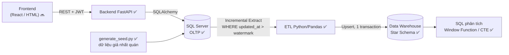
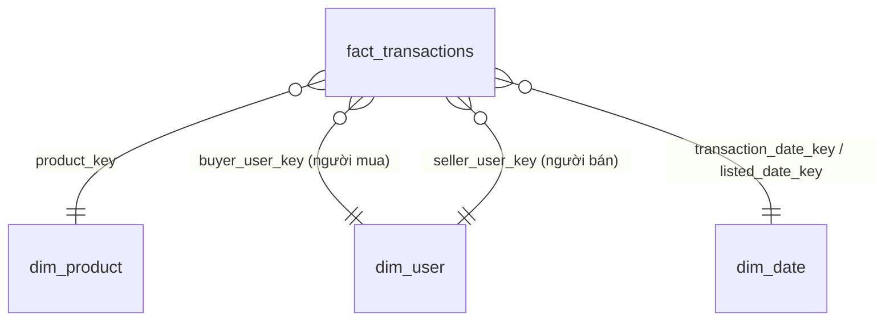

# Chợ Trời UIT (UIT Exchange)

Dự án cá nhân: hệ thống mua bán trao đổi đồ cũ nội bộ sinh viên UIT (C2C) **kết hợp** Data Pipeline phân tích hành vi giao dịch (định hướng Data Engineer).

## 🗺️ Kiến trúc & luồng dữ liệu



- **OLTP**: tối ưu ghi/đọc nhanh và toàn vẹn dữ liệu (3NF, CHECK/UNIQUE/FK, filtered unique index chống bán trùng).
- **OLAP**: ETL trích xuất *tăng dần* nhờ cột `updated_at` ở mọi bảng, làm sạch bằng Pandas rồi nạp vào Data Warehouse dạng Star Schema.

## 📊 Tiến độ

| Hạng mục | Trạng thái |
|---|---|
| Thiết kế ERD, API contract | ✅ (`docs/`) |
| Schema SQL Server + index + trigger `updated_at` | ✅ (chưa chạy thử trên SQL Server thật sau lần sửa gần nhất — xem *Kiểm thử*) |
| Backend: đăng ký/đăng nhập JWT, sản phẩm, giao dịch | ✅ |
| Sinh dữ liệu giả nhất quán + script kiểm tra | ✅ |
| Frontend | 🔜 |
| ETL incremental → Data Warehouse (Star Schema) | ✅ (test trên SQLite; chưa chạy thử trên SQL Server thật) |
| Phân tích SQL (Window Function / CTE) | ✅ |
| Lập lịch ETL tự động, Docker Compose | 🔜 |

## 📂 Cấu trúc thư mục

```text
backend/            FastAPI: main.py, models.py, schemas.py, security.py, tests/
database_scripts/   01_init_schema.sql (bảng, index, trigger), 02_seed_reference_data.sql (danh mục)
data_pipeline/      generate_seed.py, validate_seed.py (dữ liệu giả + kiểm tra nhất quán)
                    etl/ (dwh_schema, extract, transform, load, pipeline), run_etl.py
                    analytics/*.sql, run_analytics.py, tests/
docs/               api_contract.md, erd.dbml (OLTP), dwh_star_schema.dbml (DWH) - dán vào dbdiagram.io
.env.example        mẫu cấu hình (copy thành .env)
```

## 🚀 Chạy dự án

**Yêu cầu:** Python 3.12, SQL Server (Express được) và [ODBC Driver 18 for SQL Server](https://learn.microsoft.com/sql/connect/odbc/download-odbc-driver-for-sql-server).

```bash
# 1. Tạo database và schema (SSMS / Azure Data Studio, hoặc sqlcmd)
#    CREATE DATABASE ChoTroUIT;
sqlcmd -S localhost -d ChoTroUIT -E -i database_scripts/01_init_schema.sql   # ⚠️ XOÁ & tạo lại bảng
sqlcmd -S localhost -d ChoTroUIT -E -i database_scripts/02_seed_reference_data.sql

# 2. Cấu hình: copy .env.example -> .env (thư mục gốc) rồi điền DATABASE_URL và JWT_SECRET

# 3. Cài thư viện (Windows: .venv\Scripts\activate)
python -m venv .venv && source .venv/bin/activate
pip install -r backend/requirements.txt -r data_pipeline/requirements.txt

# 4. Chạy API  ->  http://localhost:8000/docs
cd backend && uvicorn main:app --reload
```

### Sinh dữ liệu giả (từ thư mục gốc repo)

```bash
python data_pipeline/generate_seed.py --reset      # mặc định: 10.000 user / 50.000 sản phẩm / 20.000 giao dịch
python data_pipeline/validate_seed.py              # kiểm tra nhất quán (thoát mã 1 nếu có vi phạm)
```
Tuỳ chọn: `--users --products --transactions --seed --end-date`. Cùng `--seed` luôn cho cùng dữ liệu.
Mọi tài khoản giả dùng chung mật khẩu `Password123!` (chỉ dùng khi phát triển).
Dữ liệu có tính mùa vụ (giáo trình đăng/bán nhiều đầu học kỳ) để các truy vấn phân tích có kết quả có ý nghĩa.

## 🔄 Data Pipeline (OLTP → Data Warehouse)

**Luồng đi của dữ liệu:** Web/API → **OLTP** (SQL Server `ChoTroUIT`) → **ETL** (`run_etl.py`) → **Data Warehouse** (database riêng `ChoTroUIT_DWH`) → **SQL phân tích**.



| Bước | Làm gì | Chi tiết |
|---|---|---|
| **Extract** | Chỉ lấy dòng thay đổi | `WHERE updated_at > watermark − 5 phút`. Lấy **giao dịch trước, rồi mới user/sản phẩm** để không có giao dịch "mồ côi" khi đăng bán xảy ra giữa hai lần đọc |
| **Transform** (Pandas) | Làm sạch & tính cột phái sinh | Chuẩn hoá ngành (`KHMT` → `Khoa học máy tính`), NULL → `Chưa xác định`, `cohort_year` từ MSSV, `discount_pct`, `days_to_sell` (chỉ giao dịch Completed), khoá ngày `YYYYMMDD` |
| **Data quality** | Cách ly dòng xấu | Sản phẩm không tồn tại, giá chốt > niêm yết, mua trước khi đăng, người mua = người bán... → ghi vào `etl_rejected_rows`, **không** nạp vào fact |
| **Load** | Upsert vào Star Schema | Dimension rồi mới tới fact, **một transaction duy nhất** (lỗi giữa chừng = không có gì thay đổi, watermark không tiến) |
| **Reconcile** | Đối chiếu số dòng nguồn ↔ kho | Lệch thì trạng thái chạy là `WARNING` (mã thoát 1) |

**Quyết định thiết kế:**
- **Watermark + cửa sổ chồng lấn 5 phút:** `updated_at` có thể commit trễ hoặc lệch đồng hồ giữa app và DB. Lùi 5 phút rồi **upsert idempotent** nên nạp trùng không gây lỗi (có test chứng minh).
- **Tiêu chí kiểm chứng chính:** kết quả nạp tăng dần phải **giống hệt** nạp lại từ đầu (`test_incremental_result_equals_full_reload`).
- **Dimension là SCD loại 1** (ghi đè, không giữ lịch sử): `dim_product.current_status` là trạng thái *hiện tại*. Muốn xem lịch sử thay đổi cần nâng lên SCD loại 2.
- **Không đưa email / MSSV / mật khẩu vào kho** (tối thiểu hoá dữ liệu cá nhân); `dim_user` chỉ có `cohort_year`, tên, ngành.
- `dim_user` dùng cho cả người mua lẫn người bán (role-playing dimension). Danh mục được gộp vào `dim_product` (star, không snowflake).
- `academic_term` (HK1 = T9–T1, HK2 = T2–T6, Hè = T7–T8) là **lịch giả định**, chỉnh ở `etl/transform.py`.
- Mỗi lần chạy được ghi vào `etl_run_log` (kể cả lần lỗi).

### Chạy ETL

```bash
# 1. Tạo database kho (một lần), rồi thêm DWH_DATABASE_URL vào .env (xem .env.example)
#    CREATE DATABASE ChoTroUIT_DWH;
# 2. Chạy ETL: tự tạo bảng + dim_date; lần đầu nạp toàn bộ, các lần sau chỉ nạp phần thay đổi
python data_pipeline/run_etl.py
python data_pipeline/run_etl.py --full-refresh     # nạp lại toàn bộ (vẫn là upsert)
python data_pipeline/run_etl.py --drop-dwh         # ⚠️ XOÁ mọi bảng DWH rồi nạp lại từ đầu
```
Mã thoát: `0` OK · `1` có cảnh báo (dòng bị từ chối / lệch số dòng) · `2` cấu hình sai · `3` lỗi. Hiện tại mỗi lần chạy đọc toàn bộ phần thay đổi vào bộ nhớ — phù hợp quy mô chục nghìn dòng; dữ liệu lớn hơn cần đọc theo lô.

### Phân tích trên Data Warehouse

```bash
python data_pipeline/run_analytics.py              # chạy cả 4 truy vấn trong data_pipeline/analytics/
python data_pipeline/run_analytics.py top3_majors_it books_peak_month
```
| Truy vấn | Câu hỏi |
|---|---|
| `top3_majors_it` | Top 3 ngành mua thiết bị IT (danh mục *Linh kiện IT* + *Bàn phím & Chuột*) nhiều nhất? |
| `books_peak_month` | Tháng nào giao dịch giáo trình cao điểm nhất? (kèm so sánh với tháng trước) |
| `days_to_sell_by_category` | Danh mục nào bán nhanh nhất, người mua mặc cả bao nhiêu %? |
| `seller_pareto` | 10 người bán hàng đầu chiếm bao nhiêu % doanh thu (cộng dồn)? |

Dữ liệu seed hiện cho người bán được chọn **đồng đều**, nên `seller_pareto` ra phân phối khá phẳng (khác thực tế, nơi vài người bán chiếm phần lớn doanh thu). Tháng đầu và tháng cuối của dữ liệu có thể chưa đủ ngày.

## 🧪 Kiểm thử

```bash
pip install -r backend/requirements-dev.txt -r data_pipeline/requirements-dev.txt
cd backend && pytest            # API + ràng buộc model, chạy trên SQLite in-memory
cd ../data_pipeline && pytest   # generator, ETL, truy vấn phân tích (chạy trên SQLite)
```
Test chạy trên SQLite nên **không** kiểm tra được filtered unique index và trigger của SQL Server — hãy kiểm tra các phần đó thủ công sau khi chạy `01_init_schema.sql`.

## 🔐 Quy tắc bảo mật đang áp dụng

- Chỉ email `@gm.uit.edu.vn` (kiểm ở client, API **và** CHECK constraint trong DB); MSSV phải trùng phần trước `@`.
- Mật khẩu băm bằng bcrypt; thông báo đăng nhập sai không tiết lộ email nào đã đăng ký.
- `seller_id`/`buyer_id` lấy từ JWT, không nhận từ client. Bí mật nằm trong `.env` (đã `.gitignore`).
- Mua hàng dùng `UPDATE ... WHERE status='Available'` nguyên tử + unique index để 2 người không mua trùng một món.

## 🌿 Quy trình Git

`main` (ổn định) ← `dev` (tích hợp) ← `feat/…`, `fix/…`, `docs/…`.
