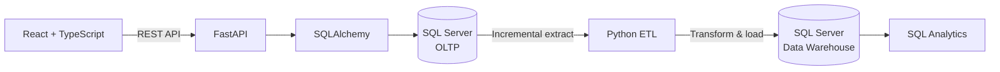
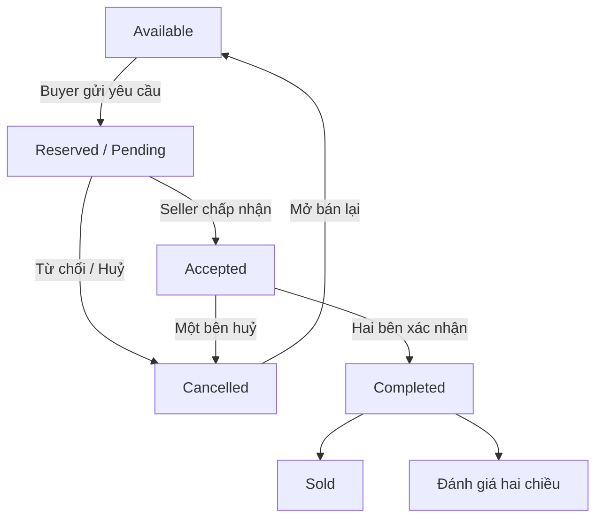

<div align="center">

# 🛒 Chợ Trời UIT

**Marketplace C2C dành cho sinh viên UIT, kèm hệ thống phân tích dữ liệu (ETL + Data Warehouse)**

*A student-to-student marketplace for UIT, backed by an incremental ETL pipeline and a Star-Schema Data Warehouse.*

[](https://github.com/Nghiepcoder17v/cho-troi-uit/actions/workflows/ci.yml)


<!-- TODO: thêm ảnh chụp màn hình hoặc GIF demo tại đây -->
<!--  -->

</div>

---

## Tổng quan

Chợ Trời UIT cho phép sinh viên Trường ĐH Công nghệ Thông tin – ĐHQG-HCM **đăng bán, tìm mua và trao đổi đồ cũ** một cách an toàn, minh bạch. Mỗi giao dịch đi qua quy trình hai bên xác nhận và kết thúc bằng đánh giá hai chiều để xây dựng uy tín.

Điểm khác biệt của dự án là **luồng dữ liệu phân tích đi kèm**: dữ liệu nghiệp vụ (OLTP) được ETL tăng dần sang Data Warehouse dạng Star Schema để trả lời các câu hỏi như *ngành nào mua nhiều thiết bị IT nhất*, *giáo trình bán chạy vào tháng nào*, *bao lâu thì một món đồ được bán*.

> **TL;DR (EN):** Full-stack C2C marketplace (React + FastAPI + SQL Server) with a transaction state machine, bilateral reviews, moderation and role-based admin controls, plus a Data Engineering track: incremental, idempotent ETL → Star-Schema DWH with SCD Type 2, scheduled runs, run logs and SQL analytics. 160+ automated tests and a 3-job CI pipeline.

## Điểm nổi bật

| | |
|---|---|
| **Quy trình giao dịch chặt chẽ** | Máy trạng thái `Available → Reserved → Accepted → Completed → Sold`; một sản phẩm chỉ có một giao dịch đang mở; hai bên xác nhận riêng biệt. |
| **Uy tín hai chiều** | Chỉ giao dịch `Completed` mới được đánh giá. |
| **Kiểm duyệt & phân quyền** | Báo cáo tin đăng, hàng đợi moderation, vai trò `MODERATOR`/`ADMIN` có audit log cấp/thu hồi quyền. |
| **Bảo mật** | bcrypt, JWT trong cookie `HttpOnly` + `Secure` + `SameSite=Lax`, kiểm tra `Origin`, danh tính buyer/seller lấy từ phiên đăng nhập, chỉ chấp nhận email `@gm.uit.edu.vn`. |
| **ETL tăng dần, idempotent** | Extract theo `updated_at` + watermark, cửa sổ overlap 5 phút, load dimension trước fact trong transaction, ghi lại dòng bị từ chối và lịch sử mỗi lần chạy. |
| **Data Warehouse** | Star Schema (`dim_user`, `dim_product`, `dim_date`, `fact_transactions`), `dim_product` theo **SCD Type 2**. |
| **Chất lượng kỹ thuật** | 160+ test (Pytest), Ruff, TypeScript build, GitHub Actions 3 job độc lập, SQL Server integration test trên database cô lập. |
| **Triển khai** | Docker Compose một lệnh: Nginx + FastAPI + SQL Server + ETL/scheduler. |

## Kiến trúc



**Vòng đời giao dịch**



Thanh toán và bàn giao hàng do hai bên tự thoả thuận bên ngoài nền tảng.

## Báo cáo phân tích

Chạy bằng `python data_pipeline/run_analytics.py --list`:

| Truy vấn | Câu hỏi trả lời |
|---|---|
| `top3_majors_it` | Top 3 ngành mua thiết bị IT nhiều nhất |
| `books_peak_month` | Tháng cao điểm giao dịch giáo trình |
| `days_to_sell_by_category` | Thời gian bán và mức giảm giá theo danh mục |
| `seller_pareto` | Mức độ tập trung doanh thu theo người bán (Pareto) |
| `listing_sell_through_by_category` | Tỷ lệ bán thành công theo danh mục |

## Công nghệ

| Lớp | Công nghệ |
|---|---|
| Frontend | React 19, TypeScript, Vite 6 |
| Backend | Python 3.12, FastAPI, Pydantic, SQLAlchemy, Uvicorn |
| Cơ sở dữ liệu | Microsoft SQL Server, pyodbc (ODBC Driver 18) |
| Data Engineering | Python, Pandas, NumPy, ETL tăng dần, SCD Type 2 |
| Bảo mật | JWT, bcrypt, HttpOnly cookie |
| Chất lượng & DevOps | Pytest, Ruff, GitHub Actions, Docker, Docker Compose, Nginx |

## Chạy nhanh với Docker

Yêu cầu: Docker Desktop.

```powershell
git clone https://github.com/Nghiepcoder17v/cho-troi-uit.git
cd cho-troi-uit
Copy-Item .env.compose.example .env.compose   # đặt MSSQL_SA_PASSWORD và JWT_SECRET
docker compose --env-file .env.compose up --build
```

Mở **http://localhost:8080**. Chạy ETL và analytics thủ công:

```powershell
docker compose --env-file .env.compose --profile tools run --rm etl
docker compose --env-file .env.compose --profile tools run --rm analytics
```

Bật ETL định kỳ: `docker compose --env-file .env.compose --profile automation up -d etl-scheduler`

> ⚠️ Cấu hình Docker dùng tài khoản `sa`, **chỉ dành cho local/dev**. Production cần application principal riêng (không thuộc `sysadmin`/`db_owner`). Xem [DB6 rollout checklist](docs/DB6_ROLLOUT_CHECKLIST.md).

Chi tiết: [docs/DOCKER_COMPOSE.md](docs/DOCKER_COMPOSE.md).

## Chạy local (không dùng Docker)

**Yêu cầu:** Python 3.12+, Node.js 20+, SQL Server 2016+ (hoặc Express), ODBC Driver 18 for SQL Server.

```powershell
# 1. Môi trường Python
python -m venv .venv
./.venv/Scripts/Activate.ps1
python -m pip install -r backend/requirements-dev.txt -r data_pipeline/requirements-dev.txt

# 2. Cấu hình (điền DATABASE_URL, DWH_DATABASE_URL, JWT_SECRET)
Copy-Item .env.example .env
python -c "import secrets; print(secrets.token_urlsafe(32))"   # tạo JWT_SECRET
```

```sql
CREATE DATABASE ChoTroUIT;
CREATE DATABASE ChoTroUIT_DWH;
```

```powershell
# 3. Khởi tạo schema (chỉ trên database MỚI)
sqlcmd -S localhost -d ChoTroUIT -E -i database_scripts/01_init_schema.sql
sqlcmd -S localhost -d ChoTroUIT -E -i database_scripts/02_seed_reference_data.sql

# 4. Backend  ->  http://localhost:8000/docs
Set-Location backend; uvicorn main:app --reload

# 5. Frontend (terminal khác)  ->  http://localhost:5173
Set-Location frontend; npm ci; npm run dev

# 6. ETL (từ thư mục gốc)
python data_pipeline/run_etl.py
```

> ⚠️ `01_init_schema.sql` **drop và tạo lại bảng**. Với database đã có dữ liệu, hãy backup và áp dụng đúng file trong `database_scripts/migrations/`.

<details>
<summary><b>Tuỳ chọn ETL & exit code</b></summary>

```powershell
python data_pipeline/run_etl.py --full-refresh        # nạp lại toàn bộ
python data_pipeline/run_etl.py --overlap-minutes 5   # chỉnh cửa sổ overlap
python data_pipeline/run_analytics.py top3_majors_it books_peak_month
```

| Exit code | Ý nghĩa |
|---:|---|
| `0` | Thành công |
| `1` | Hoàn tất nhưng có cảnh báo/dòng bị từ chối |
| `2` | Tham số hoặc cấu hình không hợp lệ |
| `3` | ETL thất bại |

`--drop-dwh` xoá toàn bộ Data Warehouse, chỉ dùng khi chủ động dựng lại từ đầu.
</details>

## Kiểm thử & CI

```powershell
cd backend;       pytest -v
cd data_pipeline; pytest -v
cd frontend;      npm ci; npm run build
```

GitHub Actions chạy 3 job độc lập: **Backend** (Ruff + Pytest), **Data Pipeline** (Ruff + Pytest), **Frontend** (TypeScript + Vite build). SQL Server integration test là opt-in, chỉ chạy trên database có tên kết thúc bằng `_test` để tránh ghi nhầm dữ liệu thật. Xem [docs/CI.md](docs/CI.md) và [docs/SQLSERVER_INTEGRATION_TESTING.md](docs/SQLSERVER_INTEGRATION_TESTING.md).

## Cấu trúc dự án

```text
cho-troi-uit/
├── backend/            # FastAPI: API, models, security, tests
├── frontend/           # React + TypeScript (pages, components, hooks)
├── data_pipeline/      # ETL, scheduler, analytics SQL, tests
├── database_scripts/   # Schema, seed, migrations, diagnostics
├── docs/               # Thiết kế, ERD, runbook, API contract
├── scripts/            # Docker init
└── docker-compose.yml
```

## API

~40 endpoint REST. Tài liệu tương tác: `http://localhost:8000/docs` khi backend đang chạy. Hợp đồng đầy đủ: [docs/api_contract.md](docs/api_contract.md).

| Nhóm | Ví dụ |
|---|---|
| Auth | `POST /api/auth/register`, `/login`, `/logout` |
| Sản phẩm | `GET/POST /api/products`, `PATCH /api/products/{id}` |
| Giao dịch | `POST /api/transactions`, `/{id}/accept`, `/{id}/confirm-completion`, `/{id}/reviews` |
| Tài khoản | `GET/PATCH /api/users/me`, `/api/transactions/purchases`, `/sales` |
| Admin | `/api/admin/users`, `/role-assignments`, `/role-events` |

## Tài liệu thiết kế

- [ERD OLTP](docs/erd.dbml) · [DWH Star Schema](docs/dwh_star_schema.dbml) · [DWH SCD Type 2](docs/DWH_SCD2.md)
- [ETL Automation](docs/ETL_AUTOMATION.md): scheduler, retry, watermark, giám sát
- [Thiết kế sự kiện giao dịch](docs/DB4_TRANSACTION_EVENT_DESIGN_2026-11-12.md) · [Báo cáo & kiểm duyệt](docs/DB6B_REPORTING_MODERATION_DESIGN_2026-11-13.md) · [Admin controls](docs/DB6D_ADMIN_CONTROLS_DESIGN_2026-11-13.md)
- [Design Profile](docs/DESIGN_PROFILE.md): định hướng UI và design tokens

## Giới hạn hiện tại

- Chưa có khoá/xoá tài khoản, kháng nghị (appeals), phân quyền hàng loạt.
- Không tích hợp thanh toán, vận chuyển hay theo dõi giao hàng.
- Lịch sử SCD Type 2 chỉ được ghi từ khi bật tính năng; ETL không thể dựng lại thay đổi cũ mà OLTP chưa lưu.

## Đóng góp

Làm việc trên nhánh `feat/*`, `fix/*`, `test/*` hoặc `docs/*`, mở Pull Request vào `main` và chờ CI xanh trước khi merge.

## Tác giả

**Hà Văn Nghiệp**, sinh viên UIT · [@Nghiepcoder17v](https://github.com/Nghiepcoder17v)
