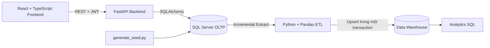
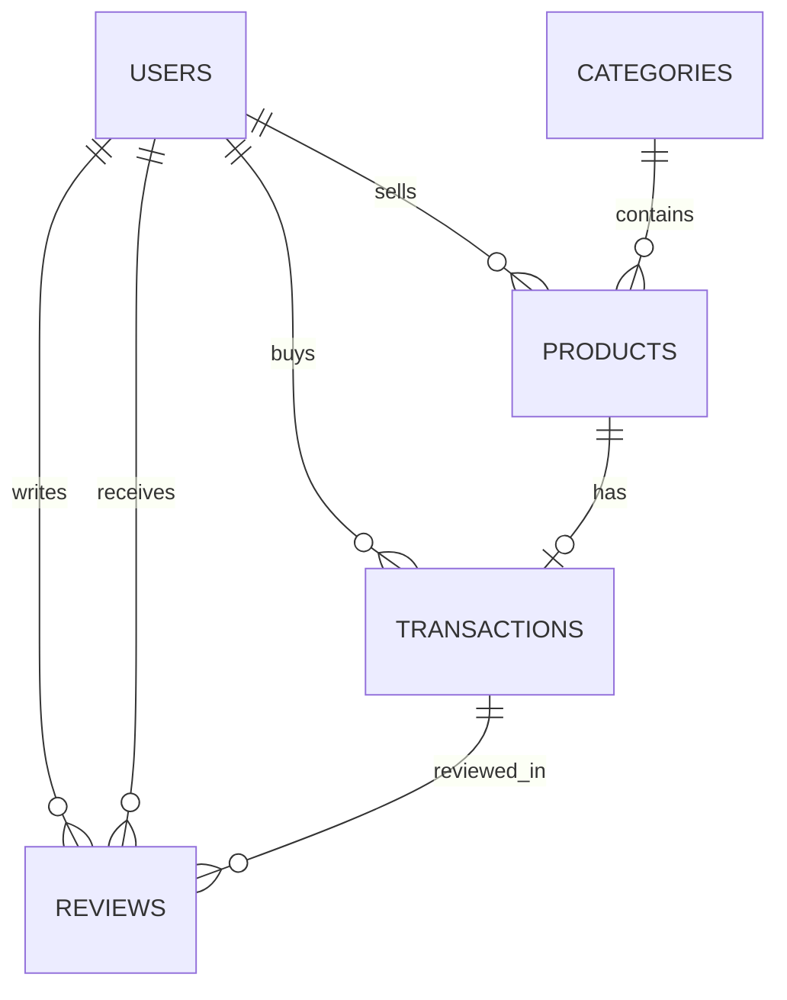

# Chợ Trời UIT

Nền tảng C2C để sinh viên UIT đăng bán, tìm mua và trao đổi đồ cũ. Repository
cung cấp marketplace React/FastAPI, SQL Server OLTP và Data Warehouse cùng
pipeline ETL, lịch chạy tự động và các báo cáo analytics.

> **Trạng thái lộ trình bàn giao:** Step 1–10 đã hoàn tất. Các phần mở rộng
> SCD Type 2 cho sản phẩm và báo cáo sell-through theo danh mục cũng đã được
> triển khai, kiểm thử và merge. Quản trị/phân quyền nâng cao là hướng phát
> triển dài hạn, chưa thuộc phạm vi đã duyệt.

## Mục lục

- [Tổng quan](#tổng-quan)
- [Trạng thái lộ trình](#trạng-thái-lộ-trình)
- [Kiến trúc](#kiến-trúc)
- [Cấu trúc dự án](#cấu-trúc-dự-án)
- [Công nghệ](#công-nghệ)
- [Yêu cầu hệ thống](#yêu-cầu-hệ-thống)
- [Cài đặt](#cài-đặt)
- [Cấu hình môi trường](#cấu-hình-môi-trường)
- [Chạy backend](#chạy-backend)
- [Chạy frontend](#chạy-frontend)
- [Chạy bằng Docker Compose](#chạy-bằng-docker-compose)
- [Vận hành và di chuyển database](#vận-hành-và-di-chuyển-database)
- [Sinh và kiểm tra dữ liệu](#sinh-và-kiểm-tra-dữ-liệu)
- [Chạy ETL và analytics](#chạy-etl-và-analytics)
- [Tự động chạy ETL](#tự-động-chạy-etl)
- [CI và chất lượng code](#ci-và-chất-lượng-code)
- [Lịch sử dimension sản phẩm](#lịch-sử-dimension-sản-phẩm)
- [API chính](#api-chính)
- [Thiết kế dữ liệu](#thiết-kế-dữ-liệu)
- [Kiểm thử](#kiểm-thử)
- [Bảo mật và toàn vẹn dữ liệu](#bảo-mật-và-toàn-vẹn-dữ-liệu)
- [Lộ trình phát triển](#lộ-trình-phát-triển)

## Tổng quan

Chợ Trời UIT giải quyết hai nhóm nhu cầu:

1. **OLTP marketplace:** sinh viên đăng bán sản phẩm, tìm kiếm sản phẩm và đặt
   mua với xác thực JWT.
2. **OLAP analytics:** dữ liệu giao dịch được trích xuất tăng dần, làm sạch và
   nạp vào Data Warehouse dạng Star Schema để chạy các báo cáo phân tích.

Luồng dữ liệu:



## Trạng thái lộ trình

| Mốc | Kết quả |
|---|---|
| Step 1 — Audit hệ thống | Hoàn thành |
| Step 2 — Design Profile | Hoàn thành; `docs/DESIGN_PROFILE.md` |
| Step 3 — UI Foundation | Hoàn thành; design tokens, theme và responsive foundation |
| Step 4 — Marketplace và Purchase Flow | Hoàn thành; yêu cầu mua, giữ chỗ, seller duyệt và hai bên xác nhận |
| Step 5 — Review và Reputation | Hoàn thành; đánh giá hai chiều sau giao dịch Completed |
| Step 6 — Account Center | Hoàn thành; hồ sơ, tin đăng, đơn mua/bán và cài đặt |
| Step 7 — Kiểm thử tích hợp | Hoàn thành; có bằng chứng tại `docs/SQLSERVER_INTEGRATION_TESTING.md` |
| Step 8 — Docker Compose | Hoàn thành; có bằng chứng tại `docs/DOCKER_COMPOSE.md` |
| Step 9 — Tự động hóa ETL | Hoàn thành; scheduler, watermark, retry và run log |
| Step 10 — CI và chất lượng code | Hoàn thành; backend, pipeline, lint và frontend build |
| Mở rộng — Product SCD Type 2 | Hoàn thành; `docs/DWH_SCD2.md` |
| Mở rộng — Analytics theo danh mục | Hoàn thành; báo cáo `listing_sell_through_by_category` |

Các mốc trên mô tả phạm vi bàn giao đã thống nhất. Phân quyền quản trị và kiểm
duyệt tin đăng nâng cao chưa được triển khai vì chưa được đưa vào phạm vi thực
hiện; có thể lập thành kế hoạch riêng sau này.

## Kiến trúc

### Backend và OLTP

- FastAPI cung cấp REST API và Swagger tại `/docs`.
- SQLAlchemy ORM ánh xạ các bảng `users`, `categories`, `products`,
  `transactions` và `reviews`.
- SQL Server là database triển khai chính.
- Schema được tạo bằng SQL script; backend **không tự động tạo bảng**.
- JWT phiên đăng nhập được đặt trong cookie `HttpOnly`, `Secure`, `SameSite=Lax`;
  frontend không lưu token trong JavaScript storage. Mật khẩu được băm bằng bcrypt.
- Account Center tách thông tin riêng tư khỏi trang cá nhân công khai; API public
  không trả email, MSSV hoặc password hash.

### Data pipeline và DWH

Pipeline chạy theo các bước:

1. **Extract:** lấy các dòng mới/thay đổi theo `updated_at` và watermark.
2. **Transform:** chuẩn hóa chuỗi, ngành học, ngày tháng và tính các chỉ số.
3. **Load:** upsert dimension trước, sau đó nạp fact trong một transaction.
4. **Reconcile:** đối chiếu số dòng nguồn với kho dữ liệu.

Pipeline dùng cửa sổ overlap mặc định 5 phút để hạn chế bỏ sót dữ liệu commit
trễ. Vì load là idempotent nên các dòng trong vùng overlap có thể được nạp lại
an toàn.

## Cấu trúc dự án

```text
cho-troi-uit/
├── backend/
│   ├── main.py                 # FastAPI routes
│   ├── database.py             # SQLAlchemy engine và DB dependency
│   ├── models.py               # ORM models
│   ├── schemas.py              # Pydantic request/response schemas
│   ├── security.py             # bcrypt, JWT và auth dependency
│   ├── requirements.txt
│   └── tests/
├── data_pipeline/
│   ├── generate_seed.py         # sinh dữ liệu phát triển
│   ├── validate_seed.py         # kiểm tra dữ liệu nguồn
│   ├── run_etl.py               # entry point ETL
│   ├── scheduler.py             # lịch ETL, retry và khóa run
│   ├── run_analytics.py         # chạy truy vấn phân tích
│   ├── etl/
│   │   ├── extract.py
│   │   ├── transform.py
│   │   ├── load.py
│   │   ├── pipeline.py
│   │   └── dwh_schema.py
│   ├── analytics/
│   └── tests/
├── database_scripts/
│   ├── 01_init_schema.sql       # reset và tạo schema OLTP (dev only)
│   ├── 02_seed_reference_data.sql
│   └── migrations/
│       ├── 20261110_purchase_requests.sql  # migration cộng thêm cho Step 4
│       └── 20261110_reviews.sql            # migration cộng thêm cho Step 5
├── docs/
│   ├── api_contract.md
│   ├── erd.dbml
│   └── dwh_star_schema.dbml
├── .env.example
└── README.md
```

## Công nghệ

- Python 3.12+
- FastAPI, Pydantic và Uvicorn
- SQLAlchemy
- SQL Server và `pyodbc`
- bcrypt và PyJWT
- Pandas và NumPy
- Pytest
- SQL analytics sử dụng CTE và window functions

## Yêu cầu hệ thống

- Python 3.12 trở lên
- SQL Server 2016 trở lên hoặc SQL Server Express
- ODBC Driver 18 for SQL Server
- Git

## Cài đặt

Từ thư mục gốc repository:

```powershell
python -m venv .venv
.\.venv\Scripts\Activate.ps1
pip install -r backend\requirements.txt -r data_pipeline\requirements.txt
pip install -r backend\requirements-dev.txt -r data_pipeline\requirements-dev.txt
```

Tạo hai database riêng:

```sql
CREATE DATABASE ChoTroUIT;
CREATE DATABASE ChoTroUIT_DWH;
```

Chạy schema OLTP bằng SSMS, Azure Data Studio hoặc `sqlcmd`:

```powershell
sqlcmd -S localhost -d ChoTroUIT -E -i database_scripts\01_init_schema.sql
sqlcmd -S localhost -d ChoTroUIT -E -i database_scripts\02_seed_reference_data.sql
```

`01_init_schema.sql` có thao tác xóa và tạo lại toàn bộ bảng, chỉ dùng khi dựng
mới/reset database phát triển. Với database đã có dữ liệu, hãy backup trước.
Nếu database chưa áp dụng Step 4, chạy
`database_scripts/migrations/20261110_purchase_requests.sql` trước; sau đó
chạy `database_scripts/migrations/20261110_reviews.sql`. Không chạy file init
schema trên database hiện hữu.

## Cấu hình môi trường

Sao chép `.env.example` thành `.env` ở thư mục gốc và điền các giá trị phù hợp:

```dotenv
DATABASE_URL=mssql+pyodbc://@localhost/ChoTroUIT?driver=ODBC+Driver+18+for+SQL+Server&trusted_connection=yes&TrustServerCertificate=yes
DWH_DATABASE_URL=mssql+pyodbc://@localhost/ChoTroUIT_DWH?driver=ODBC+Driver+18+for+SQL+Server&trusted_connection=yes&TrustServerCertificate=yes
JWT_SECRET=thay-bang-chuoi-ngau-nhien-it-nhat-32-ky-tu
ACCESS_TOKEN_EXPIRE_MINUTES=1440
```

Tạo secret:

```powershell
python -c "import secrets; print(secrets.token_urlsafe(32))"
```

Không commit `.env`. File này đã nằm trong `.gitignore`.

Các biến trong `.env` dành cho chạy backend và pipeline trực tiếp trên máy.
Docker Compose dùng file riêng `.env.compose`; không dùng chung connection URL
giữa hai cách chạy. Tham khảo [`.env.compose.example`](.env.compose.example) và
[hướng dẫn Compose](docs/DOCKER_COMPOSE.md).

## Chạy backend

```powershell
Set-Location backend
..\.venv\Scripts\Activate.ps1
uvicorn main:app --reload
```

Nếu dùng virtual environment riêng trong `backend\env`:

```powershell
.\env\Scripts\Activate.ps1
uvicorn main:app --reload
```

Các địa chỉ hữu ích:

- Health check: `http://localhost:8000/`
- Swagger UI: `http://localhost:8000/docs`
- OpenAPI JSON: `http://localhost:8000/openapi.json`

## Chạy frontend

Frontend MVP nằm trong thư mục `frontend/` và dùng React + TypeScript + Vite.
Node.js 20 trở lên được khuyến nghị.

```powershell
Set-Location frontend
npm install
npm run dev
```

Mặc định frontend chạy tại `http://localhost:5173` và gọi backend tại
`http://localhost:8000`. Có thể thay đổi bằng file `frontend/.env.local`:

```dotenv
VITE_API_URL=http://localhost:8000
```

Backend cần cho phép origin frontend bằng cấu hình ở `.env`:

```dotenv
CORS_ORIGINS=http://localhost:5173
```

Build production:

```powershell
npm run build
npm run preview
```

Frontend hiện có khám phá sản phẩm với tìm kiếm, lọc danh mục và phân trang;
đăng nhập/đăng ký; đăng bán; chi tiết sản phẩm; Account Center chia thành tổng
quan, hồ sơ cá nhân, trang cá nhân công khai, quản lý tin đăng, đơn mua, đơn bán,
giỏ hàng và cài đặt. Checkout gửi yêu cầu mua, không thu tiền trong hệ thống.
Sản phẩm được giữ chỗ đến khi seller chấp nhận/từ chối hoặc một bên hủy. Buyer
và seller phải xác nhận hoàn tất riêng biệt trước khi giao dịch thành Completed.

## Sinh và kiểm tra dữ liệu

Từ thư mục gốc, sau khi cấu hình `DATABASE_URL`:

```powershell
python data_pipeline\generate_seed.py --reset
python data_pipeline\validate_seed.py
```

Mặc định generator tạo dữ liệu phát triển quy mô lớn. Có thể tùy chỉnh:

```powershell
python data_pipeline\generate_seed.py --users 300 --products 1200 --transactions 500 --seed 42
```

Các tài khoản seed dùng mật khẩu `Password123!`; chỉ sử dụng trong môi trường
phát triển.

## Chạy ETL và analytics

### ETL

```powershell
python data_pipeline\run_etl.py
```

Các chế độ:

```powershell
python data_pipeline\run_etl.py --full-refresh
python data_pipeline\run_etl.py --drop-dwh
python data_pipeline\run_etl.py --overlap-minutes 5
```

- `0`: chạy thành công.
- `1`: chạy xong nhưng có cảnh báo hoặc dòng bị từ chối.
- `2`: cấu hình hoặc tham số không hợp lệ.
- `3`: ETL thất bại.

`--drop-dwh` xóa toàn bộ bảng Data Warehouse, chỉ dùng khi muốn dựng lại kho
từ đầu.

### Analytics

```powershell
python data_pipeline\run_analytics.py --list
python data_pipeline\run_analytics.py
python data_pipeline\run_analytics.py top3_majors_it books_peak_month
```

Các báo cáo hiện có:

| Truy vấn | Mục đích |
|---|---|
| `top3_majors_it` | Top 3 ngành mua thiết bị IT |
| `books_peak_month` | Tháng cao điểm của giao dịch giáo trình |
| `days_to_sell_by_category` | Thời gian bán và mức giảm giá theo danh mục |
| `seller_pareto` | Tỷ trọng doanh thu lũy kế của người bán |
| `listing_sell_through_by_category` | Tồn tin theo trạng thái, doanh thu hoàn tất và tỷ lệ sell-through theo danh mục |

Sell-through được tính bằng số tin có giao dịch `Completed` chia cho tổng số tin trong danh mục. Báo cáo nhóm theo danh mục hiện hành; trạng thái lịch sử và khóa fact được giữ trong `dim_product` SCD Type 2.

## Tự động chạy ETL

Compose có scheduler tùy chọn, chạy ngay một lượt khi khởi động rồi lặp lại theo
`ETL_INTERVAL_SECONDS` (mặc định 3600 giây). Bật scheduler riêng để không làm
thay đổi hành vi chạy app thông thường:

```powershell
docker compose --env-file .env.compose --profile automation up -d etl-scheduler
docker compose --env-file .env.compose logs -f etl-scheduler
```

Watermark, trạng thái từng lần chạy và dòng bị từ chối được ghi ở DWH. Scheduler
retry lỗi với backoff cấu hình được, giữ khóa ứng dụng SQL Server để ngăn nhiều
instance chạy ETL đồng thời. Lần chạy lại không tạo fact trùng hoặc phiên bản
dimension mới nếu thuộc tính không đổi. Xem [hướng dẫn vận hành](docs/ETL_AUTOMATION.md).

## CI và chất lượng code

GitHub Actions tự chạy backend tests, data pipeline tests, Ruff lint và frontend build khi có Pull Request. SQL Server integration tests cần database riêng có hậu tố `_test` nên được giữ opt-in. Xem [tài liệu CI](docs/CI.md).

## Lịch sử dimension sản phẩm

Data Warehouse lưu phiên bản lịch sử của tin đăng trong `dim_product`; fact gắn với phiên bản có hiệu lực tại thời điểm giao dịch. Khi nâng DWH cũ, áp dụng migration trước khi chạy ETL. Xem [hướng dẫn SCD Type 2](docs/DWH_SCD2.md).

## API chính

Chi tiết request/response nằm trong [`docs/api_contract.md`](docs/api_contract.md).

| Method | Endpoint | Mô tả | Auth |
|---|---|---|---|
| `GET` | `/` | Health check | Không |
| `POST` | `/api/auth/register` | Đăng ký tài khoản UIT | Không |
| `POST` | `/api/auth/login` | Đăng nhập; backend đặt cookie phiên HttpOnly | Không |
| `POST` | `/api/auth/logout` | Xóa cookie phiên | Không |
| `GET` | `/api/users/me` | Thông tin tài khoản hiện tại | Có |
| `PATCH` | `/api/users/me` | Cập nhật họ tên và ngành học | Có |
| `POST` | `/api/users/me/change-password` | Đổi mật khẩu sau khi xác minh mật khẩu hiện tại | Có |
| `GET` | `/api/users/{id}/public-profile` | Thông tin hồ sơ công khai, không gồm email/MSSV | Không |
| `GET` | `/api/users/{id}/products` | Tin đăng công khai Available/Sold của người dùng | Không |
| `GET` | `/api/users/{id}/reputation` | Điểm trung bình và phân phối đánh giá thật | Không |
| `GET` | `/api/users/{id}/reviews` | Danh sách đánh giá người dùng nhận được | Không |
| `GET` | `/api/categories` | Danh sách danh mục | Không |
| `GET` | `/api/products` | Tìm kiếm và phân trang sản phẩm | Không |
| `GET` | `/api/products/mine` | Danh sách sản phẩm của tôi | Có |
| `GET` | `/api/products/{product_id}` | Xem chi tiết sản phẩm | Không |
| `POST` | `/api/products` | Đăng sản phẩm | Có |
| `PATCH` | `/api/products/{product_id}` | Cập nhật hoặc ẩn sản phẩm của tôi | Có |
| `POST` | `/api/transactions` | Gửi yêu cầu mua và giữ chỗ | Có |
| `POST` | `/api/transactions/{id}/accept` | Người bán chấp nhận yêu cầu | Có |
| `POST` | `/api/transactions/{id}/reject` | Người bán từ chối yêu cầu | Có |
| `POST` | `/api/transactions/{id}/cancel` | Một bên hủy giao dịch đang mở | Có |
| `POST` | `/api/transactions/{id}/confirm-completion` | Buyer/seller xác nhận hoàn tất | Có |
| `POST` | `/api/transactions/{id}/reviews` | Gửi đánh giá đối phương sau Completed | Có |
| `PATCH` | `/api/reviews/{id}` | Tác giả chỉnh sửa đánh giá của mình | Có |
| `GET` | `/api/transactions/purchases` | Lịch sử mua hàng | Có |
| `GET` | `/api/transactions/sales` | Lịch sử bán hàng | Có |

Quy tắc nghiệp vụ chính:

- Email phải thuộc miền `@gm.uit.edu.vn`.
- MSSV gồm 8 chữ số và phải khớp phần trước `@` của email.
- Người dùng không thể mua sản phẩm của chính mình.
- Giá đề nghị không được cao hơn giá niêm yết; khi seller chấp nhận, đây là giá giao dịch đã thống nhất.
- Tạo yêu cầu mua chỉ giữ chỗ sản phẩm (`Available → Reserved`), chưa coi là giao dịch hoàn tất.
- Seller phải chấp nhận yêu cầu; seller có thể từ chối để mở bán lại sản phẩm.
- Buyer và seller xác nhận riêng; chỉ khi cả hai xác nhận, transaction thành `Completed` và product thành `Sold`.
- Một bên có thể hủy ở trạng thái `Pending` hoặc `Accepted`; sản phẩm trở lại `Available`.
- Sản phẩm `Reserved` không xuất hiện trong danh sách công khai và không thể chỉnh sửa; chủ sở hữu vẫn xem được trong `/api/products/mine`.
- Sản phẩm `Hidden` không xuất hiện trong API công khai.
- Thanh toán và bàn giao diễn ra bên ngoài nền tảng; không tích hợp payment/shipping.

## Thiết kế dữ liệu

### OLTP



Các bảng chính:

- `users`: tài khoản và thông tin sinh viên.
- `categories`: danh mục sản phẩm.
- `products`: tin đăng và trạng thái `Available`, `Reserved`, `Sold`, `Hidden`.
- `transactions`: yêu cầu/giao dịch với trạng thái `Pending`, `Accepted`, `Completed`, `Cancelled`; có timestamp xác nhận riêng cho buyer và seller.

### Data Warehouse

Star Schema gồm:

- `dim_user`: người mua/người bán, dùng role-playing dimension.
- `dim_product`: sản phẩm và danh mục.
- `dim_date`: lịch ngày, học kỳ và thuộc tính thời gian.
- `fact_transactions`: số đo giao dịch, giá niêm yết, giá chốt, chiết khấu và
  thời gian bán.
- `etl_watermark`, `etl_run_log`, `etl_rejected_rows`: điều khiển và audit ETL.

`dim_product` dùng SCD Type 2: ETL lưu các phiên bản thuộc tính tin đăng và fact
tham chiếu phiên bản có hiệu lực tại thời điểm giao dịch. `dim_user` và
`dim_date` vẫn dùng SCD Type 1. Email, MSSV và password hash không được đưa vào
Data Warehouse để giảm dữ liệu định danh không cần thiết. SCD2 chỉ ghi nhận
thay đổi ETL quan sát sau khi tính năng được bật; xem [giới hạn và hướng dẫn
migration](docs/DWH_SCD2.md).

Sơ đồ chi tiết:

- [OLTP ERD](docs/erd.dbml)
- [DWH Star Schema](docs/dwh_star_schema.dbml)

## Kiểm thử

Backend:

```powershell
Set-Location backend
pytest
```

Data pipeline:

```powershell
Set-Location data_pipeline
pytest
```

Test bao phủ:

- đăng ký, đăng nhập bằng cookie JWT HttpOnly, đăng xuất và kiểm tra Origin;
- review hai chiều, phân quyền theo giao dịch, chỉ cho phép sau Completed,
  sửa review của tác giả và tính điểm trung bình;
- cập nhật hồ sơ cá nhân, đổi mật khẩu, giới hạn dữ liệu trang cá nhân công khai,
  quản lý trạng thái tin đăng và lọc đơn mua/đơn bán;
- validate sản phẩm và phân trang;
- chống mua trùng trong transaction;
- model constraints;
- transform và chuẩn hóa dữ liệu;
- ETL initial, incremental, full refresh và idempotency;
- watermark, overlap window và quarantine dòng lỗi;
- kiểm tra các truy vấn analytics.

Các test mặc định chạy trên SQLite để không yêu cầu SQL Server. Bộ integration
test bật riêng đã chạy thành công trên SQL Server Express cục bộ; xem
[biên bản Step 7](docs/SQLSERVER_INTEGRATION_TESTING.md) để biết phạm vi và kết quả.

SQL Server integration test được opt-in để tránh vô tình ghi lên database khác.
Chỉ chạy trên database kiểm thử riêng có tên kết thúc bằng `_test`, sau khi đọc
[hướng dẫn kiểm thử SQL Server](docs/SQLSERVER_INTEGRATION_TESTING.md):

```powershell
$env:SQLSERVER_TEST_DATABASE_URL = "mssql+pyodbc://@localhost/ChoTroUIT_Step7_Test?driver=ODBC+Driver+18+for+SQL+Server&trusted_connection=yes&TrustServerCertificate=yes"
$env:RUN_SQLSERVER_INTEGRATION = "1"
Set-Location backend
pytest -v -m sqlserver_integration
```

## Chạy bằng Docker Compose

Compose chạy frontend production qua Nginx, FastAPI, SQL Server với hai database
OLTP/DWH và các lệnh ETL/analytics tùy chọn. Hướng dẫn cấu hình, khởi tạo an toàn
và lệnh vận hành nằm tại [docs/DOCKER_COMPOSE.md](docs/DOCKER_COMPOSE.md).

Tóm tắt khởi động từ PowerShell ở thư mục gốc:

```powershell
Copy-Item .env.compose.example .env.compose
# Điền MSSQL_SA_PASSWORD và JWT_SECRET trong .env.compose trước khi chạy.
docker compose --env-file .env.compose up --build
```

Mở `http://localhost:8080`. Dừng container mà vẫn giữ database bằng:

```powershell
docker compose --env-file .env.compose down
```

Database nằm trong Docker named volume; xóa volume sẽ xóa OLTP và DWH. Scheduler
ETL không bật mặc định. Xem [tài liệu Compose](docs/DOCKER_COMPOSE.md) và
[hướng dẫn scheduler](docs/ETL_AUTOMATION.md) trước khi bật automation.

## Vận hành và di chuyển database

- `database_scripts/01_init_schema.sql` có thao tác drop bảng; chỉ dùng khi tạo
  mới hoặc chủ động reset database phát triển. Không chạy trên database đang có
  dữ liệu cần giữ.
- Với OLTP cũ, sao lưu và kiểm tra migration đã áp dụng trước khi chạy. Migration
  purchase request và review lần lượt là
  `database_scripts/migrations/20261110_purchase_requests.sql` và
  `database_scripts/migrations/20261110_reviews.sql`.
- Với DWH tạo trước SCD Type 2, sao lưu rồi áp dụng
  `database_scripts/migrations/20261111_dwh_product_scd2.sql` trước khi chạy ETL
  mới. Xem [hướng dẫn nâng cấp DWH](docs/DWH_SCD2.md).
- Docker initializer không tự áp dụng migration cho database hiện hữu. Xác nhận
  trạng thái schema trước khi trỏ backend hoặc ETL vào database đó.
- Không dùng `generate_seed.py --reset` hoặc `run_etl.py --drop-dwh` trên dữ liệu
  cần giữ. `--drop-dwh` xóa toàn bộ Data Warehouse.

## Bảo mật và toàn vẹn dữ liệu

- Mật khẩu chỉ được lưu dưới dạng bcrypt hash.
- Cookie phiên dùng `HttpOnly`, `Secure`, `SameSite=Lax`; các request thay đổi dữ liệu
  có cookie phải gửi `Origin` trong danh sách `CORS_ORIGINS`.
- JWT secret và connection strings chỉ nằm trong `.env` hoặc `.env.compose` cục bộ; không commit các file này.
- API không nhận `seller_id` hoặc `buyer_id` từ client; các giá trị này lấy từ
  token.
- SQL Server dùng foreign key, CHECK constraint và unique constraint.
- Giữ chỗ `Available → Reserved` dùng điều kiện nguyên tử; chỉ chuyển `Reserved → Sold` sau xác nhận từ hai bên.
- Filtered unique index giới hạn một giao dịch chưa hủy trên mỗi sản phẩm.
- Review có unique constraint theo `(transaction_id, reviewer_id)`, CHECK
  rating 1–5; chỉ buyer/seller của giao dịch Completed mới được ghi review.
- Migration cộng thêm ở `database_scripts/migrations/20261110_purchase_requests.sql`
  và `database_scripts/migrations/20261110_reviews.sql`; không chạy lại `01_init_schema.sql` trên database hiện hữu.
- Dữ liệu lỗi trong ETL được ghi vào `etl_rejected_rows`, không âm thầm nạp vào
  fact.

## Lộ trình phát triển

- [x] Step 1–6: audit, thiết kế, UI foundation, marketplace, review và Account Center.
- [x] Step 7: kiểm chứng backend, SQL Server integration, pipeline, frontend build và smoke test ([kết quả](docs/SQLSERVER_INTEGRATION_TESTING.md)).
- [x] Step 8: đóng gói và kiểm chứng môi trường Docker Compose ([hướng dẫn/kết quả](docs/DOCKER_COMPOSE.md)).
- [x] Step 9: scheduler ETL, watermark, retry, log và khóa chạy đồng thời ([hướng dẫn/kết quả](docs/ETL_AUTOMATION.md)).
- [x] Step 10: CI cho backend, data pipeline, lint và frontend build ([cấu hình](docs/CI.md)).
- [x] Mở rộng DWH: SCD Type 2 cho lịch sử sản phẩm ([chi tiết](docs/DWH_SCD2.md)).
- [x] Mở rộng analytics: sell-through và trạng thái listing theo danh mục.

Lộ trình bàn giao ban đầu đã hoàn thành. Phân quyền quản trị và kiểm duyệt tin
đăng nâng cao là đề xuất dài hạn chưa được duyệt phạm vi hoặc triển khai; cần
được xác định yêu cầu và kế hoạch riêng trước khi bắt đầu.

## Quy trình Git đề xuất

```text
main (ổn định)
└── dev (tích hợp)
    ├── feat/<ten-tinh-nang>
    ├── fix/<ten-loi>
    └── docs/<ten-tai-lieu>
```

## Tác giả

**Hà Văn Nghiệp** — [Nghiepcoder17v](https://github.com/Nghiepcoder17v)
