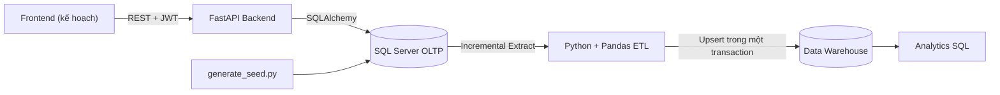
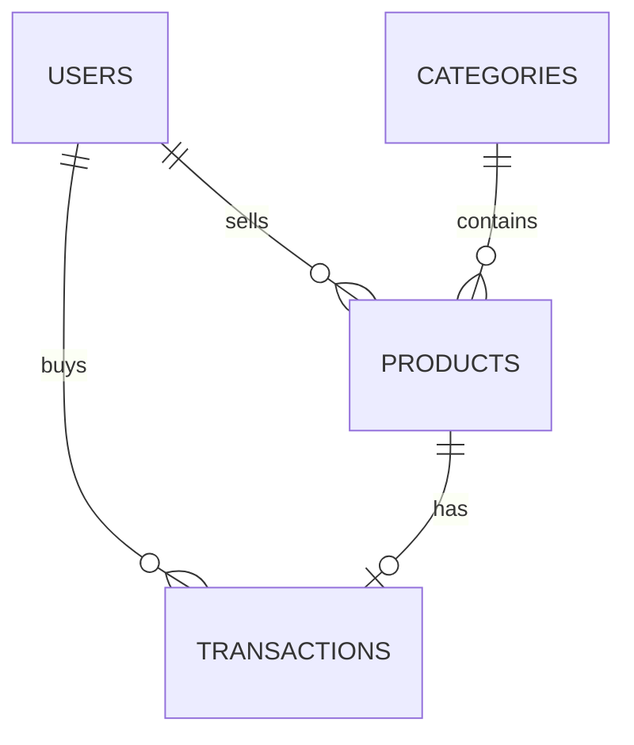

# Chợ Trời UIT

Hệ thống mua bán và trao đổi đồ cũ nội bộ dành cho sinh viên UIT (C2C), kết hợp
backend REST, cơ sở dữ liệu giao dịch và data pipeline phục vụ phân tích hành vi
giao dịch.

> Trạng thái hiện tại: backend và data pipeline đã có test tự động trên SQLite.
> Frontend, Docker Compose, lập lịch ETL và kiểm thử đầy đủ trên SQL Server là
> các hạng mục tiếp theo.

## Mục lục

- [Tổng quan](#tổng-quan)
- [Kiến trúc](#kiến-trúc)
- [Cấu trúc dự án](#cấu-trúc-dự-án)
- [Công nghệ](#công-nghệ)
- [Yêu cầu hệ thống](#yêu-cầu-hệ-thống)
- [Cài đặt](#cài-đặt)
- [Cấu hình môi trường](#cấu-hình-môi-trường)
- [Chạy backend](#chạy-backend)
- [Sinh và kiểm tra dữ liệu](#sinh-và-kiểm-tra-dữ-liệu)
- [Chạy ETL và analytics](#chạy-etl-và-analytics)
- [API chính](#api-chính)
- [Thiết kế dữ liệu](#thiết-kế-dữ-liệu)
- [Kiểm thử](#kiểm-thử)
- [Bảo mật và toàn vẹn dữ liệu](#bảo-mật-và-toàn-vẹn-dữ-liệu)
- [Lộ trình phát triển](#lộ-trình-phát-triển)

## Tổng quan

Chợ Trời UIT giải quyết hai nhóm nhu cầu:

1. **OLTP marketplace:** sinh viên đăng bán sản phẩm, tìm kiếm sản phẩm và đặt
   mua với xác thực JWT.
2. **OLAP analytics:** dữ liệu giao dịch được trích xuất tăng dần, làm sạch và
   nạp vào Data Warehouse dạng Star Schema để chạy các báo cáo phân tích.

Luồng dữ liệu:



## Kiến trúc

### Backend và OLTP

- FastAPI cung cấp REST API và Swagger tại `/docs`.
- SQLAlchemy ORM ánh xạ các bảng `users`, `categories`, `products` và
  `transactions`.
- SQL Server là database triển khai chính.
- Schema được tạo bằng SQL script; backend **không tự động tạo bảng**.
- JWT xác thực người dùng và bcrypt băm mật khẩu.

### Data pipeline và DWH

Pipeline chạy theo các bước:

1. **Extract:** lấy các dòng mới/thay đổi theo `updated_at` và watermark.
2. **Transform:** chuẩn hóa chuỗi, ngành học, ngày tháng và tính các chỉ số.
3. **Load:** upsert dimension trước, sau đó nạp fact trong một transaction.
4. **Reconcile:** đối chiếu số dòng nguồn với kho dữ liệu.

Pipeline dùng cửa sổ overlap mặc định 5 phút để hạn chế bỏ sót dữ liệu commit
trễ. Vì load là idempotent nên các dòng trong vùng overlap có thể được nạp lại
an toàn.

## Cấu trúc dự án

```text
cho-troi-uit/
├── backend/
│   ├── main.py                 # FastAPI routes
│   ├── database.py             # SQLAlchemy engine và DB dependency
│   ├── models.py               # ORM models
│   ├── schemas.py              # Pydantic request/response schemas
│   ├── security.py             # bcrypt, JWT và auth dependency
│   ├── requirements.txt
│   └── tests/
├── data_pipeline/
│   ├── generate_seed.py         # sinh dữ liệu phát triển
│   ├── validate_seed.py         # kiểm tra dữ liệu nguồn
│   ├── run_etl.py               # entry point ETL
│   ├── run_analytics.py         # chạy truy vấn phân tích
│   ├── etl/
│   │   ├── extract.py
│   │   ├── transform.py
│   │   ├── load.py
│   │   ├── pipeline.py
│   │   └── dwh_schema.py
│   ├── analytics/
│   └── tests/
├── database_scripts/
│   ├── 01_init_schema.sql       # reset và tạo schema OLTP
│   └── 02_seed_reference_data.sql
├── docs/
│   ├── api_contract.md
│   ├── erd.dbml
│   └── dwh_star_schema.dbml
├── .env.example
└── README.md
```

## Công nghệ

- Python 3.12+
- FastAPI, Pydantic và Uvicorn
- SQLAlchemy
- SQL Server và `pyodbc`
- bcrypt và PyJWT
- Pandas và NumPy
- Pytest
- SQL analytics sử dụng CTE và window functions

## Yêu cầu hệ thống

- Python 3.12 trở lên
- SQL Server 2016 trở lên hoặc SQL Server Express
- ODBC Driver 18 for SQL Server
- Git

## Cài đặt

Từ thư mục gốc repository:

```powershell
python -m venv .venv
.\.venv\Scripts\Activate.ps1
pip install -r backend\requirements.txt -r data_pipeline\requirements.txt
pip install -r backend\requirements-dev.txt -r data_pipeline\requirements-dev.txt
```

Tạo hai database riêng:

```sql
CREATE DATABASE ChoTroUIT;
CREATE DATABASE ChoTroUIT_DWH;
```

Chạy schema OLTP bằng SSMS, Azure Data Studio hoặc `sqlcmd`:

```powershell
sqlcmd -S localhost -d ChoTroUIT -E -i database_scripts\01_init_schema.sql
sqlcmd -S localhost -d ChoTroUIT -E -i database_scripts\02_seed_reference_data.sql
```

`01_init_schema.sql` có thao tác xóa và tạo lại toàn bộ bảng, chỉ nên dùng cho
môi trường phát triển.

## Cấu hình môi trường

Sao chép `.env.example` thành `.env` ở thư mục gốc và điền các giá trị phù hợp:

```dotenv
DATABASE_URL=mssql+pyodbc://@localhost/ChoTroUIT?driver=ODBC+Driver+18+for+SQL+Server&trusted_connection=yes&TrustServerCertificate=yes
DWH_DATABASE_URL=mssql+pyodbc://@localhost/ChoTroUIT_DWH?driver=ODBC+Driver+18+for+SQL+Server&trusted_connection=yes&TrustServerCertificate=yes
JWT_SECRET=thay-bang-chuoi-ngau-nhien-it-nhat-32-ky-tu
ACCESS_TOKEN_EXPIRE_MINUTES=1440
```

Tạo secret:

```powershell
python -c "import secrets; print(secrets.token_urlsafe(32))"
```

Không commit `.env`. File này đã nằm trong `.gitignore`.

## Chạy backend

```powershell
Set-Location backend
..\.venv\Scripts\Activate.ps1
uvicorn main:app --reload
```

Nếu dùng virtual environment riêng trong `backend\env`:

```powershell
.\env\Scripts\Activate.ps1
uvicorn main:app --reload
```

Các địa chỉ hữu ích:

- Health check: `http://localhost:8000/`
- Swagger UI: `http://localhost:8000/docs`
- OpenAPI JSON: `http://localhost:8000/openapi.json`

## Sinh và kiểm tra dữ liệu

Từ thư mục gốc, sau khi cấu hình `DATABASE_URL`:

```powershell
python data_pipeline\generate_seed.py --reset
python data_pipeline\validate_seed.py
```

Mặc định generator tạo dữ liệu phát triển quy mô lớn. Có thể tùy chỉnh:

```powershell
python data_pipeline\generate_seed.py --users 300 --products 1200 --transactions 500 --seed 42
```

Các tài khoản seed dùng mật khẩu `Password123!`; chỉ sử dụng trong môi trường
phát triển.

## Chạy ETL và analytics

### ETL

```powershell
python data_pipeline\run_etl.py
```

Các chế độ:

```powershell
python data_pipeline\run_etl.py --full-refresh
python data_pipeline\run_etl.py --drop-dwh
python data_pipeline\run_etl.py --overlap-minutes 5
```

- `0`: chạy thành công.
- `1`: chạy xong nhưng có cảnh báo hoặc dòng bị từ chối.
- `2`: cấu hình hoặc tham số không hợp lệ.
- `3`: ETL thất bại.

`--drop-dwh` xóa toàn bộ bảng Data Warehouse, chỉ dùng khi muốn dựng lại kho
từ đầu.

### Analytics

```powershell
python data_pipeline\run_analytics.py --list
python data_pipeline\run_analytics.py
python data_pipeline\run_analytics.py top3_majors_it books_peak_month
```

Các báo cáo hiện có:

| Truy vấn | Mục đích |
|---|---|
| `top3_majors_it` | Top 3 ngành mua thiết bị IT |
| `books_peak_month` | Tháng cao điểm của giao dịch giáo trình |
| `days_to_sell_by_category` | Thời gian bán và mức giảm giá theo danh mục |
| `seller_pareto` | Tỷ trọng doanh thu lũy kế của người bán |

## API chính

Chi tiết request/response nằm trong [`docs/api_contract.md`](docs/api_contract.md).

| Method | Endpoint | Mô tả | Auth |
|---|---|---|---|
| `GET` | `/` | Health check | Không |
| `POST` | `/api/auth/register` | Đăng ký tài khoản UIT | Không |
| `POST` | `/api/auth/login` | Đăng nhập và nhận JWT | Không |
| `GET` | `/api/users/me` | Thông tin tài khoản hiện tại | Có |
| `GET` | `/api/categories` | Danh sách danh mục | Không |
| `GET` | `/api/products` | Tìm kiếm và phân trang sản phẩm | Không |
| `GET` | `/api/products/mine` | Danh sách sản phẩm của tôi | Có |
| `GET` | `/api/products/{product_id}` | Xem chi tiết sản phẩm | Không |
| `POST` | `/api/products` | Đăng sản phẩm | Có |
| `PATCH` | `/api/products/{product_id}` | Cập nhật hoặc ẩn sản phẩm của tôi | Có |
| `POST` | `/api/transactions` | Đặt mua sản phẩm | Có |
| `GET` | `/api/transactions/purchases` | Lịch sử mua hàng | Có |
| `GET` | `/api/transactions/sales` | Lịch sử bán hàng | Có |

Quy tắc nghiệp vụ chính:

- Email phải thuộc miền `@gm.uit.edu.vn`.
- MSSV gồm 8 chữ số và phải khớp phần trước `@` của email.
- Người dùng không thể mua sản phẩm của chính mình.
- Giá chốt không được cao hơn giá niêm yết.
- Sản phẩm chỉ có thể được mua một lần.
- Sản phẩm `Hidden` không xuất hiện trong API công khai.

## Thiết kế dữ liệu

### OLTP



Các bảng chính:

- `users`: tài khoản và thông tin sinh viên.
- `categories`: danh mục sản phẩm.
- `products`: tin đăng và trạng thái `Available`, `Sold`, `Hidden`.
- `transactions`: giao dịch với trạng thái `Pending`, `Completed`, `Cancelled`.

### Data Warehouse

Star Schema gồm:

- `dim_user`: người mua/người bán, dùng role-playing dimension.
- `dim_product`: sản phẩm và danh mục.
- `dim_date`: lịch ngày, học kỳ và thuộc tính thời gian.
- `fact_transactions`: số đo giao dịch, giá niêm yết, giá chốt, chiết khấu và
  thời gian bán.
- `etl_watermark`, `etl_run_log`, `etl_rejected_rows`: điều khiển và audit ETL.

Dimension hiện sử dụng SCD Type 1. Email, MSSV và password hash không được đưa
vào Data Warehouse để giảm dữ liệu định danh không cần thiết.

Sơ đồ chi tiết:

- [OLTP ERD](docs/erd.dbml)
- [DWH Star Schema](docs/dwh_star_schema.dbml)

## Kiểm thử

Backend:

```powershell
Set-Location backend
pytest
```

Data pipeline:

```powershell
Set-Location data_pipeline
pytest
```

Test bao phủ:

- đăng ký, đăng nhập và JWT;
- validate sản phẩm và phân trang;
- chống mua trùng trong transaction;
- model constraints;
- transform và chuẩn hóa dữ liệu;
- ETL initial, incremental, full refresh và idempotency;
- watermark, overlap window và quarantine dòng lỗi;
- kiểm tra các truy vấn analytics.

Test tự động hiện chạy trên SQLite để không yêu cầu SQL Server. Vì vậy cần
kiểm thử bổ sung trên SQL Server thật cho filtered unique index, trigger
`updated_at`, driver ODBC và tương thích dialect.

## Bảo mật và toàn vẹn dữ liệu

- Mật khẩu chỉ được lưu dưới dạng bcrypt hash.
- JWT secret và connection strings chỉ nằm trong `.env`.
- API không nhận `seller_id` hoặc `buyer_id` từ client; các giá trị này lấy từ
  token.
- SQL Server dùng foreign key, CHECK constraint và unique constraint.
- Cập nhật `Available → Sold` dùng điều kiện nguyên tử.
- Filtered unique index giới hạn một giao dịch chưa hủy trên mỗi sản phẩm.
- Dữ liệu lỗi trong ETL được ghi vào `etl_rejected_rows`, không âm thầm nạp vào
  fact.

## Lộ trình phát triển

- [ ] Xây dựng frontend.
- [ ] Chạy kiểm thử tích hợp trên SQL Server thật.
- [ ] Thêm Docker Compose cho OLTP, DWH, API và ETL.
- [ ] Lập lịch chạy ETL tự động.
- [ ] Bổ sung phân quyền và quản lý tin đăng.
- [ ] Nâng dimension cần thiết lên SCD Type 2 để lưu lịch sử.
- [ ] Thêm CI chạy test và kiểm tra chất lượng code.

## Quy trình Git đề xuất

```text
main (ổn định)
└── dev (tích hợp)
    ├── feat/<ten-tinh-nang>
    ├── fix/<ten-loi>
    └── docs/<ten-tai-lieu>
```

## Tác giả

**Hà Văn Nghiệp** — [Nghiepcoder17v](https://github.com/Nghiepcoder17v)
