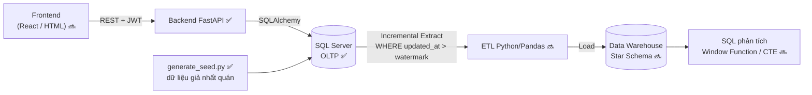

# Chợ Trời UIT (UIT Exchange)

Dự án cá nhân: hệ thống mua bán trao đổi đồ cũ nội bộ sinh viên UIT (C2C) **kết hợp** Data Pipeline phân tích hành vi giao dịch (định hướng Data Engineer).

## 🗺️ Kiến trúc & luồng dữ liệu



- **OLTP**: tối ưu ghi/đọc nhanh và toàn vẹn dữ liệu (3NF, CHECK/UNIQUE/FK, filtered unique index chống bán trùng).
- **OLAP**: ETL trích xuất *tăng dần* nhờ cột `updated_at` ở mọi bảng, làm sạch bằng Pandas rồi nạp vào Data Warehouse dạng Star Schema.

## 📊 Tiến độ

| Hạng mục | Trạng thái |
|---|---|
| Thiết kế ERD, API contract | ✅ (`docs/`) |
| Schema SQL Server + index + trigger `updated_at` | ✅ (chưa chạy thử trên SQL Server thật sau lần sửa gần nhất — xem *Kiểm thử*) |
| Backend: đăng ký/đăng nhập JWT, sản phẩm, giao dịch | ✅ |
| Sinh dữ liệu giả nhất quán + script kiểm tra | ✅ |
| Frontend | 🔜 |
| ETL incremental → Data Warehouse (Star Schema) | 🔜 |
| Phân tích SQL, lập lịch ETL, Docker Compose | 🔜 |

## 📂 Cấu trúc thư mục

```text
backend/            FastAPI: main.py, models.py, schemas.py, security.py, tests/
database_scripts/   01_init_schema.sql (bảng, index, trigger), 02_seed_reference_data.sql (danh mục)
data_pipeline/      generate_seed.py (dữ liệu giả), validate_seed.py (kiểm tra nhất quán), tests/
docs/               api_contract.md, erd.dbml (dán vào dbdiagram.io)
.env.example        mẫu cấu hình (copy thành .env)
```

## 🚀 Chạy dự án

**Yêu cầu:** Python 3.12, SQL Server (Express được) và [ODBC Driver 18 for SQL Server](https://learn.microsoft.com/sql/connect/odbc/download-odbc-driver-for-sql-server).

```bash
# 1. Tạo database và schema (SSMS / Azure Data Studio, hoặc sqlcmd)
#    CREATE DATABASE ChoTroUIT;
sqlcmd -S localhost -d ChoTroUIT -E -i database_scripts/01_init_schema.sql   # ⚠️ XOÁ & tạo lại bảng
sqlcmd -S localhost -d ChoTroUIT -E -i database_scripts/02_seed_reference_data.sql

# 2. Cấu hình: copy .env.example -> .env (thư mục gốc) rồi điền DATABASE_URL và JWT_SECRET

# 3. Cài thư viện (Windows: .venv\Scripts\activate)
python -m venv .venv && source .venv/bin/activate
pip install -r backend/requirements.txt -r data_pipeline/requirements.txt

# 4. Chạy API  ->  http://localhost:8000/docs
cd backend && uvicorn main:app --reload
```

### Sinh dữ liệu giả (từ thư mục gốc repo)

```bash
python data_pipeline/generate_seed.py --reset      # mặc định: 10.000 user / 50.000 sản phẩm / 20.000 giao dịch
python data_pipeline/validate_seed.py              # kiểm tra nhất quán (thoát mã 1 nếu có vi phạm)
```
Tuỳ chọn: `--users --products --transactions --seed --end-date`. Cùng `--seed` luôn cho cùng dữ liệu.
Mọi tài khoản giả dùng chung mật khẩu `Password123!` (chỉ dùng khi phát triển).
Dữ liệu có tính mùa vụ (giáo trình đăng/bán nhiều đầu học kỳ) để các truy vấn phân tích có kết quả có ý nghĩa.

## 🧪 Kiểm thử

```bash
pip install -r backend/requirements-dev.txt -r data_pipeline/requirements-dev.txt
cd backend && pytest            # API + ràng buộc model, chạy trên SQLite in-memory
cd ../data_pipeline && pytest   # generator + các quy tắc nhất quán
```
Test chạy trên SQLite nên **không** kiểm tra được filtered unique index và trigger của SQL Server — hãy kiểm tra các phần đó thủ công sau khi chạy `01_init_schema.sql`.

## 🔐 Quy tắc bảo mật đang áp dụng

- Chỉ email `@gm.uit.edu.vn` (kiểm ở client, API **và** CHECK constraint trong DB); MSSV phải trùng phần trước `@`.
- Mật khẩu băm bằng bcrypt; thông báo đăng nhập sai không tiết lộ email nào đã đăng ký.
- `seller_id`/`buyer_id` lấy từ JWT, không nhận từ client. Bí mật nằm trong `.env` (đã `.gitignore`).
- Mua hàng dùng `UPDATE ... WHERE status='Available'` nguyên tử + unique index để 2 người không mua trùng một món.

## 🌿 Quy trình Git

`main` (ổn định) ← `dev` (tích hợp) ← `feat/…`, `fix/…`, `docs/…`.
